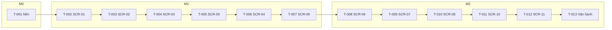

# Backlog

> ⚠ **Specs đổi ngày 2026-11-19 (Q-055..Q-058)** — task bị ảnh hưởng, cần chạy lại `backlog-task-detail`: T-003, T-004, T-006, T-007 (viết lại), T-011. Xem ghi chú đầu mỗi task.

> Cập nhật: 2026-11-19 · Nguồn: `specs/` (Phase 3 chốt ngày 2026-11-19) · Chi tiết phạm vi: `backlog/_draft/slices.md` · Quyết định: Q-053

## 1. Thiết lập
| Mục | Giá trị |
|---|---|
| Cách làm | **Waterfall, 1 dev + AI**: làm tuần tự T-001 → T-013, **1 task = 1 màn** (UI + Server Action + dữ liệu/rules + test của màn đó). Thêm task nền (T-001) và vận hành (T-013) (Q-053) |
| Thang story point | Fibonacci `1, 2, 3, 5, 8, 13, 21`. Màn lớn để nguyên 1 task nên được phép > 8 (Q-053) |
| Unit / integration test | Vitest + Firebase Emulator Suite: logic thuần (sinh vé, kiểm Kinh, rule) và Server Action trên emulator |
| E2E test | **AI chạy kịch bản trên Chrome** (Claude in Chrome) với localhost, viewport điện thoại 375×812; nhiều người chơi = nhiều profile/cửa sổ Chrome. Mỗi task có bảng "Kịch bản test trên Chrome" (bước + kết quả mong đợi) (Q-053) |
| Môi trường kiểm tra | Local (`npm run dev`) + Firebase Emulator Suite; không deploy (Q-053) |
| Năng lực nhóm | 1 dev + AI; không chia thời gian/sprint (Q-053) |

### Definition of Done chung
- [ ] Mọi acceptance criteria đạt trên local + emulator
- [ ] Unit/integration test của task viết xong và pass (`npm test`)
- [ ] Lint / type check pass
- [ ] AI đã chạy hết kịch bản test trên Chrome của task, ghi kết quả (pass/fail + ảnh chụp khi fail)
- [ ] Chạy lại nhanh kịch bản chính của các task trước (smoke) — không hỏng
- [ ] Dev review code do AI viết

## 2. Milestone
| Milestone | Mục tiêu (demo được gì khi xong) | Task | Tổng point |
|---|---|---|---|
| M0 | Nền: app trống chạy trên local + emulator, test/lint xanh | T-001 | 3 |
| M1 | Chơi trọn một ván: đăng nhập → tạo phòng → mời → chọn vé → chơi, rao, Kinh → host xác nhận → ván mới | T-002 → T-007 | 55 |
| M2 | Đủ tính năng MVP: chat, người trong phòng (kick), lịch sử, hồ sơ & đăng xuất, cài đặt, vận hành | T-008 → T-013 | 21 |
| | | **Tổng** | **79** |

## 3. Epic
| EPIC | Tên | BIZ / SUP | Task |
|---|---|---|---|
| EPIC-00 | Nền dự án | — | T-001 |
| EPIC-01 | Đăng nhập (SCR-01) | BIZ-01, SUP-05 | T-002 |
| EPIC-02 | Trang chủ & tạo phòng (SCR-02) | BIZ-02, BIZ-01 | T-003 |
| EPIC-03 | Lời mời (SCR-03) | BIZ-03, SUP-06 | T-004 |
| EPIC-04 | Chọn vé (SCR-05) | BIZ-04, BIZ-05, SUP-04 | T-005 |
| EPIC-05 | Ván chơi (SCR-04, SCR-09) | BIZ-06, BIZ-07, BIZ-08, BIZ-11, BIZ-14, SUP-01, SUP-02, SUP-03, SUP-10 | T-006, T-007 |
| EPIC-06 | Chat (SCR-06) | BIZ-12, SUP-07 | T-008 |
| EPIC-07 | Người trong phòng (SCR-07) | BIZ-10, BIZ-04 | T-009 |
| EPIC-08 | Lịch sử ván (SCR-08) | BIZ-13 | T-010 |
| EPIC-09 | Hồ sơ & đăng xuất (SCR-10) | BIZ-16, BIZ-01, SUP-08 | T-011 |
| EPIC-10 | Cài đặt (SCR-11) | BIZ-15, BIZ-06 | T-012 |
| EPIC-11 | Vận hành | SUP-09 | T-013 |

## 4. Danh sách task
| ID | Tiêu đề | Màn | Epic | Milestone | Point | Phụ thuộc | Trạng thái | File |
|---|---|---|---|---|---|---|---|---|
| T-001 | Dựng nền dự án chạy được trên local + emulator | — | EPIC-00 | M0 | 3 | — | DONE | [T-001](tasks/T-001-project-foundation.md) |
| T-002 | Đăng nhập Google | SCR-01 | EPIC-01 | M1 | 5 | T-001 | DONE | [T-002](tasks/T-002-google-sign-in.md) |
| T-003 | Trang chủ & tạo phòng | SCR-02 | EPIC-02 | M1 | 8 | T-002 | DONE | [T-003](tasks/T-003-home-create-room.md) |
| T-004 | Lời mời & vào phòng | SCR-03 | EPIC-03 | M1 | 5 | T-003 | DONE | [T-004](tasks/T-004-invite-join-room.md) |
| T-005 | Chọn vé | SCR-05 | EPIC-04 | M1 | 8 | T-004 | TODO | [T-005](tasks/T-005-ticket-selection.md) |
| T-006 | Phòng chơi | SCR-04 | EPIC-05 | M1 | 21 | T-005 | TODO | [T-006](tasks/T-006-game-room.md) |
| T-007 | Kết quả ván | SCR-09 | EPIC-05 | M1 | 8 | T-006 | TODO | [T-007](tasks/T-007-game-result.md) |
| T-008 | Chat | SCR-06 | EPIC-06 | M2 | 3 | T-007 | TODO | [T-008](tasks/T-008-room-chat.md) |
| T-009 | Người trong phòng | SCR-07 | EPIC-07 | M2 | 5 | T-008 | TODO | [T-009](tasks/T-009-room-members.md) |
| T-010 | Lịch sử ván | SCR-08 | EPIC-08 | M2 | 2 | T-009 | TODO | [T-010](tasks/T-010-game-history.md) |
| T-011 | Hồ sơ cá nhân & đăng xuất | SCR-10 | EPIC-09 | M2 | 5 | T-010 | TODO | [T-011](tasks/T-011-profile-and-sign-out.md) |
| T-012 | Cài đặt | SCR-11 | EPIC-10 | M2 | 3 | T-011 | TODO | [T-012](tasks/T-012-room-settings.md) |
| T-013 | Vận hành: thống kê ngày, TTL, theo dõi lỗi | — | EPIC-11 | M2 | 3 | T-012 | TODO | [T-013](tasks/T-013-ops-stats-ttl-logging.md) |

Trạng thái: `TODO` / `IN-PROGRESS` / `REVIEW` / `DONE`.

## 5. Dependency

## 6. Ngoài phạm vi backlog
| Mục | Lý do | Nguồn |
|---|---|---|
| Kho tiếng rao thật (AI tạo audio) | Làm ngoài ứng dụng; T-006 dùng bộ audio mẫu | BIZ-09, Q-018 |
| Deploy App Hosting, đo tải 800 người | Chỉ kiểm local + emulator | Q-053, NFR-06 |
| Push, đa ngôn ngữ, nhật ký diễn biến ván, thanh toán | Ngoài MVP | SUP-11..SUP-14 |
