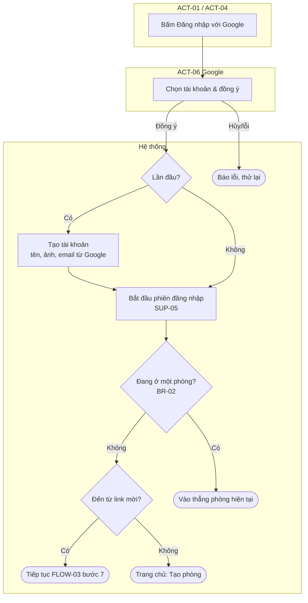

### FLOW-01 Đăng nhập bằng Google (BIZ-01)
- **Actor:** ACT-01/ACT-04, ACT-06 Google, ACT-05 Hệ thống · **Trigger:** Mở ứng dụng hoặc link mời khi chưa đăng nhập · **Kết quả:** Người dùng đã đăng nhập, được đưa tới đúng nơi

- **Happy path:**
  1. Người dùng bấm "Đăng nhập với Google" (BR-01).
  2. Google cho chọn tài khoản và đồng ý chia sẻ tên, ảnh, email.
  3. Hệ thống kiểm tra tài khoản đã tồn tại chưa.
  4. Lần đầu: tạo tài khoản với tên, ảnh, email từ Google.
  5. Bắt đầu phiên đăng nhập (SUP-05).
  6. Nếu đang ở một phòng còn hoạt động → vào thẳng phòng đó.
  7. Nếu đến từ link mời → tiếp tục FLOW-03 bước 7.
  8. Còn lại → trang chủ với nút "Tạo phòng".
- **Alternative paths:**
  - A1. Đã có phiên đăng nhập còn hiệu lực: bỏ qua bước 1–5, đi thẳng bước 6.
  - A2. Người dùng đăng xuất: kết thúc phiên; vẫn là thành viên phòng (offline) cho tới khi rời hoặc phòng đóng.
  - A3. Người dùng đã tự đổi tên/ảnh (BIZ-16): đăng nhập lại không ghi đè bằng tên/ảnh Google.
- **Exceptions:**
  - E1. Người dùng hủy ở Google hoặc Google lỗi: báo "Đăng nhập không thành công, thử lại", ở lại màn đăng nhập.
  - E2. Đang mở trong trình duyệt của ứng dụng chat không cho đăng nhập Google: hiện hướng dẫn "Mở bằng trình duyệt" kèm nút copy link, giữ nguyên link mời (NFR-13).
- **Supporting kích hoạt:** SUP-05 tại bước 5; SUP-09 (đếm người dùng mới/hoạt động) tại bước 4–5.
- **Business rules áp dụng:** BR-01 bước 1; BR-02 bước 6.
