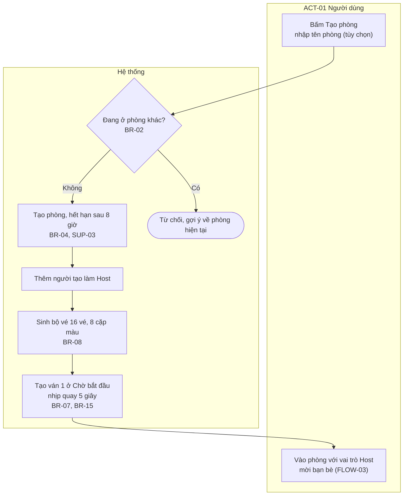

### FLOW-02 Tạo phòng (BIZ-02)
- **Actor:** ACT-01 (trở thành ACT-02), ACT-05 Hệ thống · **Trigger:** Bấm "Tạo phòng" · **Kết quả:** Phòng mới với bộ vé và ván Chờ bắt đầu

- **Happy path:**
  1. Người dùng bấm "Tạo phòng", có thể nhập tên; để trống thì dùng "Phòng của <tên>".
  2. Hệ thống kiểm tra người dùng không ở phòng nào (BR-02).
  3. Tạo phòng Đang hoạt động, hết hạn sau 8 giờ; đặt hẹn giờ cảnh báo 15 phút và đóng phòng (BR-04, SUP-03).
  4. Thêm người tạo làm thành viên vai trò Host.
  5. Sinh bộ vé 16 vé: 8 màu × 2 vé; mỗi vé 9 hàng × 9 cột, mỗi hàng 5 số; 2 vé cùng màu gộp đủ 1–90 (BR-08).
  6. Tạo ván số 1 ở Chờ bắt đầu, nhịp quay mặc định 5 giây (BR-07, BR-15).
  7. Host vào phòng, thấy bộ vé, nút Mời, nút Bắt đầu (bị khóa tới khi có vé được giữ).
- **Alternative paths:**
  - A1. Host lấy vé cho mình ngay (FLOW-05).
- **Exceptions:**
  - E1. Người dùng đang ở phòng khác: báo "Bạn đang ở phòng <tên>", có nút về phòng đó.
- **Supporting kích hoạt:** SUP-03 tại bước 3; SUP-09 (đếm phòng) tại bước 3.
- **Business rules áp dụng:** BR-02 bước 2; BR-04 bước 3; BR-08 bước 5; BR-07, BR-15 bước 6.
