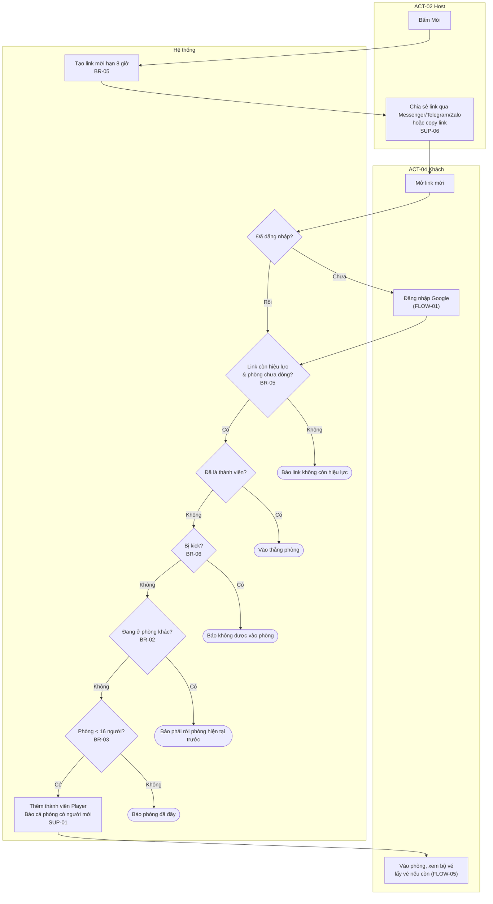

### FLOW-03 Mời & tham gia phòng (BIZ-03)
- **Actor:** ACT-02 Host, ACT-04 Khách / ACT-01 Người dùng, ACT-05 Hệ thống · **Trigger:** Host bấm "Mời"; khách mở link mời · **Kết quả:** Khách trở thành Player trong phòng

- **Happy path:**
  1. Host bấm "Mời".
  2. Hệ thống hiện link mời đã tạo sẵn cùng phòng, hết hạn cùng phòng (BR-05, cập nhật từ Phase 3 – Q-046).
  3. Host chia sẻ link bằng nút chia sẻ của thiết bị hoặc copy link; khi dán vào ứng dụng chat, link hiện thẻ xem trước gồm tên phòng, tên host, ảnh (SUP-06).
  4. Khách mở link.
  5. Hệ thống kiểm tra khách đã đăng nhập chưa.
  6. Chưa đăng nhập thì khách đăng nhập Google (FLOW-01); xong quay lại đúng link (SUP-05).
  7. Hệ thống kiểm tra link còn hiệu lực và phòng chưa đóng (BR-05).
  8. Kiểm tra khách chưa phải thành viên đang trong phòng.
  9. Kiểm tra khách không bị kick khỏi phòng này (BR-06).
  10. Kiểm tra khách không đang ở phòng khác (BR-02).
  11. Kiểm tra phòng còn dưới 16 người (BR-03).
  12. Thêm khách làm thành viên Player; cả phòng thấy "<tên> đã vào phòng" (SUP-01).
  13. Khách xem phòng, bộ vé, danh sách thành viên, chat; lấy vé nếu ván đang Chờ bắt đầu và còn vé (FLOW-05). Hết vé thì ở lại xem.
- **Alternative paths:**
  - A1. Khách đã là thành viên đang trong phòng (vd mở lại link): vào thẳng phòng, không thêm mới.
  - A2. Khách từng tự rời phòng: được vào lại như thành viên mới, không được trả vé cũ (BR-25).
  - A3. Khách vào khi ván đang chạy: xem ván, nghe rao, chat; không lấy vé tới khi ván kết thúc (BR-10).
  - A4. Host bấm "Mời" lần nữa: luôn hiện cùng một link, tạo sẵn lúc tạo phòng và hết hạn cùng phòng (cập nhật từ Phase 3 – Q-046).
- **Exceptions:**
  - E1. Link hết hạn hoặc phòng đã đóng: báo "Link không còn hiệu lực", đưa về trang chủ.
  - E2. Khách bị kick khỏi phòng: báo "Bạn không thể vào phòng này".
  - E3. Khách đang ở phòng khác: báo phải rời phòng hiện tại, có nút về phòng hiện tại.
  - E4. Phòng đủ 16 người: báo "Phòng đã đầy".
  - E5. Khách hủy đăng nhập Google: dừng, link vẫn mở lại được.
- **Supporting kích hoạt:** SUP-03 tại bước 2 (hẹn giờ hết hạn link); SUP-06 tại bước 3; SUP-05 tại bước 6; SUP-01 tại bước 12.
- **Business rules áp dụng:** BR-05 bước 2, 7; BR-06 bước 9; BR-02 bước 10; BR-03 bước 11; BR-10 tại A3; BR-25 tại A2.
