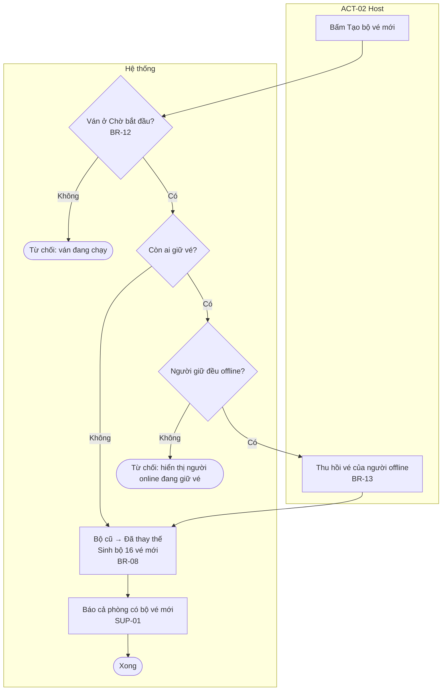

### FLOW-04 Tạo lại bộ vé (BIZ-04)
- **Actor:** ACT-02 Host, ACT-05 Hệ thống · **Trigger:** Host bấm "Tạo bộ vé mới" · **Kết quả:** Bộ vé mới hiện hành, mọi vé trống

- **Happy path:**
  1. Host bấm "Tạo bộ vé mới".
  2. Hệ thống kiểm tra ván hiện tại ở Chờ bắt đầu (BR-12).
  3. Kiểm tra không còn ai giữ vé.
  4. Bộ vé cũ chuyển Đã thay thế; sinh bộ 16 vé mới (BR-08).
  5. Cả phòng thấy bộ vé mới (SUP-01).
- **Alternative paths:**
  - A1. Chỉ còn người offline giữ vé: hệ thống liệt kê họ, host bấm "Thu hồi vé"; vé về Trống, người đó thấy thông báo khi online lại (BR-13, SUP-04). Sau đó tiếp bước 4.
  - A2. Host thu hồi vé người offline mà không tạo bộ mới: vé về Trống, người khác lấy được.
- **Exceptions:**
  - E1. Ván đang chạy/tạm dừng/chờ xác nhận: từ chối.
  - E2. Còn người online giữ vé: từ chối, hiển thị ai đang giữ để host nhắc họ bỏ vé.
- **Supporting kích hoạt:** SUP-04 tại bước 3/A1; SUP-01 tại bước 5, A1.
- **Business rules áp dụng:** BR-12 bước 2–3; BR-13 tại A1, A2; BR-08 bước 4.
