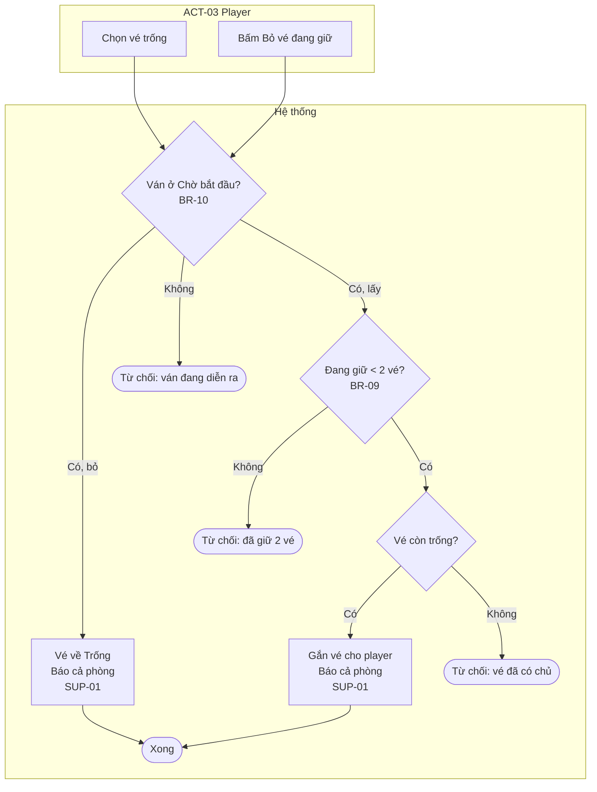

### FLOW-05 Lấy / bỏ vé (BIZ-05)
- **Actor:** ACT-03 Player (gồm host), ACT-05 Hệ thống · **Trigger:** Player chọn vé trống / bỏ vé đang giữ · **Kết quả:** Player giữ 0–2 vé

- **Happy path (lấy vé):**
  1. Player xem bộ vé: màu, vé đã có chủ (tên, ảnh), vé trống; chọn một vé trống.
  2. Hệ thống kiểm tra ván ở Chờ bắt đầu (BR-10).
  3. Kiểm tra player đang giữ dưới 2 vé (BR-09).
  4. Kiểm tra vé còn trống (người đến trước được).
  5. Gắn vé cho player; cả phòng thấy vé đã có chủ (SUP-01).
- **Alternative paths:**
  - A1. Bỏ vé: player bấm "Bỏ vé"; ván ở Chờ bắt đầu thì vé về Trống, cả phòng thấy (SUP-01).
  - A2. Hết vé trống: player ở lại xem, chờ người khác bỏ vé ở ván sau.
  - A3. Vé giữ từ ván trước: vẫn thuộc player, không cần lấy lại (BR-11).
- **Exceptions:**
  - E1. Ván đang chạy/tạm dừng/chờ xác nhận: nút lấy/bỏ bị khóa.
  - E2. Đã giữ 2 vé: báo "Tối đa 2 vé".
  - E3. Hai người cùng chọn một vé: người sau báo "Vé đã có người lấy".
- **Supporting kích hoạt:** SUP-01 tại bước 5, A1.
- **Business rules áp dụng:** BR-10 bước 2; BR-09 bước 3, 4; BR-11 tại A3.
