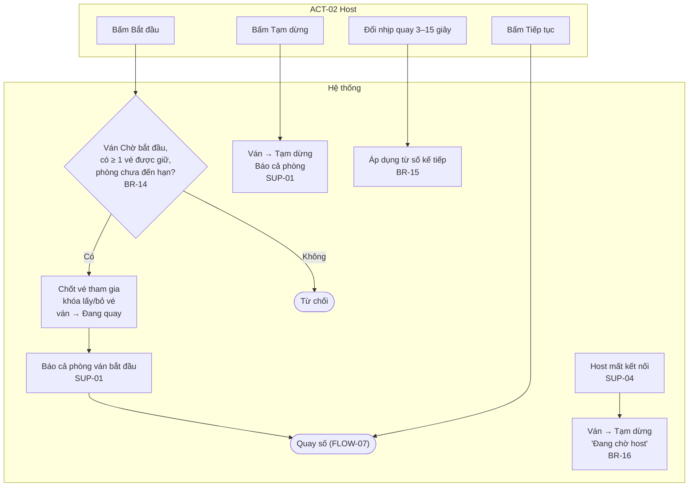

### FLOW-06 Điều khiển ván (BIZ-06)
- **Actor:** ACT-02 Host, ACT-05 Hệ thống · **Trigger:** Host bấm Bắt đầu / Tạm dừng / Tiếp tục / đổi nhịp; host mất kết nối · **Kết quả:** Trạng thái ván cập nhật cho mọi người

- **Happy path (bắt đầu):**
  1. Host bấm "Bắt đầu".
  2. Hệ thống kiểm tra: ván ở Chờ bắt đầu, có ít nhất 1 vé được giữ, phòng chưa đến hạn đóng (BR-14).
  3. Chốt danh sách vé tham gia (vé đang có người giữ); khóa lấy/bỏ vé; ván chuyển Đang quay.
  4. Cả phòng thấy "Ván <n> bắt đầu" (SUP-01).
  5. Quay số bắt đầu (FLOW-07).
- **Alternative paths:**
  - A1. Tạm dừng: host bấm "Tạm dừng" → ván Tạm dừng, cả phòng thấy (SUP-01); ngừng quay số.
  - A2. Tiếp tục: host bấm "Tiếp tục" → ván Đang quay, quay số tiếp (FLOW-07).
  - A3. Đổi nhịp: host chọn 3–15 giây; áp dụng từ số kế tiếp; cả phòng thấy nhịp mới (BR-15).
  - A4. Host mất kết nối khi ván Đang quay: ván tự Tạm dừng, cả phòng thấy "Đang chờ host" (BR-16, SUP-04). Host kết nối lại thì thấy nút "Tiếp tục" (A2).
  - A5. Bắt đầu ván thứ 2 trở đi: giống bước 1–5, sau khi ván trước Kết thúc (FLOW-08).
- **Exceptions:**
  - E1. Không có vé nào được giữ: nút Bắt đầu bị khóa, gợi ý "Cần ít nhất 1 người lấy vé".
  - E2. Phòng Chờ đóng / sắp đến hạn đóng: không cho bắt đầu ván mới (BR-14).
  - E3. Người không phải host: không thấy nút điều khiển.
- **Supporting kích hoạt:** SUP-01 tại bước 4, A1, A3, A4; SUP-04 tại A4; SUP-03 tại bước 5 (bắt đầu đếm nhịp); SUP-09 (đếm ván) tại bước 3.
- **Business rules áp dụng:** BR-14 bước 2; BR-10 bước 3 (khóa vé); BR-15 tại A3; BR-16 tại A1, A4.
