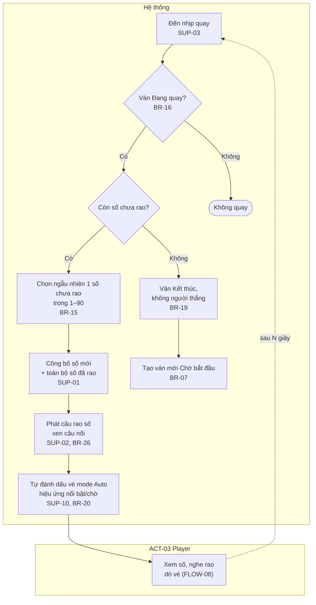

### FLOW-07 Quay số & rao (BIZ-07)
- **Actor:** ACT-05 Hệ thống (chính), ACT-03 Player (xem, nghe) · **Trigger:** Thời gian, mỗi N giây khi ván Đang quay · **Kết quả:** Số mới được công bố và rao

- **Happy path:**
  1. Đến nhịp quay (N giây sau số trước, N theo cài đặt phòng) (SUP-03).
  2. Hệ thống kiểm tra ván Đang quay (không tạm dừng, không đang kiểm tra Kinh/chờ đồng kinh/chờ xác nhận) (BR-16).
  3. Kiểm tra còn số chưa rao.
  4. Chọn ngẫu nhiên 1 số chưa rao trong 1–90 (BR-15).
  5. Mọi thành viên thấy số mới và toàn bộ số đã rao (SUP-01, BR-20).
  6. Phát câu rao cho số đó (chọn ngẫu nhiên nếu nhiều câu), xen câu nối giữa các số; người tắt tiếng không nghe (SUP-02, BR-26).
  7. Vé của player mode Auto được tự đánh dấu; số trúng nổi bật, hàng thiếu 1 số đánh dấu "chờ" (SUP-10, BR-20).
  8. Player xem số, nghe rao, dò vé, có thể bấm Kinh (FLOW-08). Lặp lại bước 1.
- **Alternative paths:**
  - A1. Số không có câu rao trong kho: chỉ hiển thị số, không phát tiếng (Q-029).
  - A2. Host đổi nhịp giữa chừng: nhịp mới tính từ số kế tiếp (FLOW-06 A3).
- **Exceptions:**
  - E1. Ván không ở Đang quay: không quay.
  - E2. Đã rao đủ 90 số mà không ai kinh đúng: ván Kết thúc không người thắng, lưu vào lịch sử, cả phòng được báo (BR-19, SUP-01).
  - E3. Sau E2: tạo ván mới ở Chờ bắt đầu (BR-07).
- **Supporting kích hoạt:** SUP-03 bước 1; SUP-01 bước 5, E2; SUP-02 bước 6; SUP-10 bước 7.
- **Business rules áp dụng:** BR-16 bước 2; BR-15 bước 4; BR-20 bước 5, 7; BR-26 bước 6; BR-19 tại E2; BR-07 tại E3.
