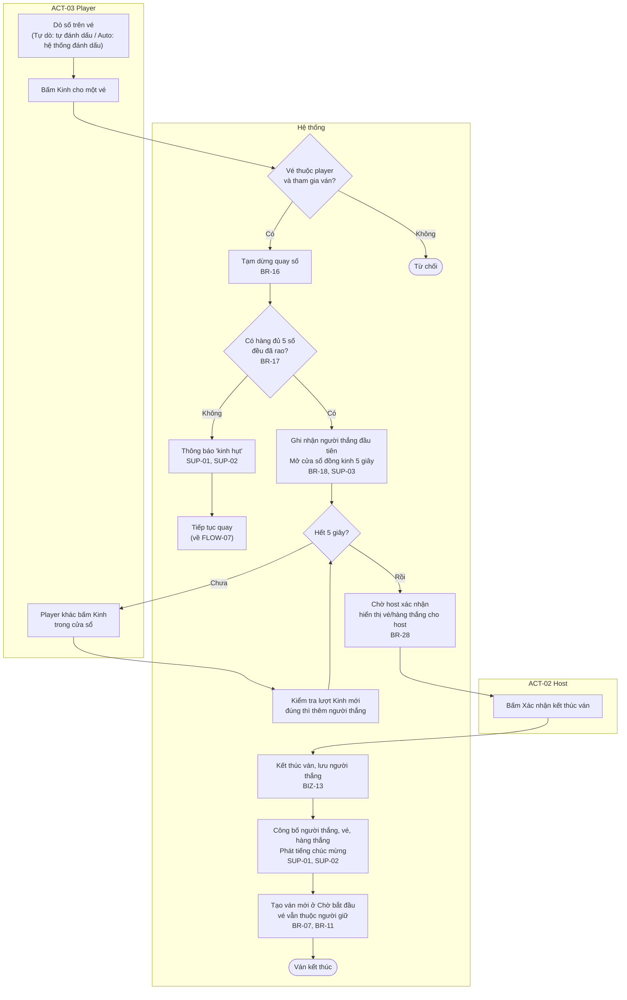

### FLOW-08 Dò số & báo Kinh (BIZ-08)
- **Actor:** ACT-03 Player (chính), ACT-05 Hệ thống, ACT-02 Host (xác nhận) · **Trigger:** Player bấm "Kinh" cho một vé · **Kết quả:** Kinh hụt và ván quay tiếp, hoặc ván Kết thúc với danh sách người thắng và ván mới ở Chờ bắt đầu

- **Happy path:**
  1. Player dò số trên vé: mode Tự dò thì tự đánh dấu, mode Auto thì hệ thống đánh dấu và làm nổi bật hàng "chờ" (BR-20, SUP-10).
  2. Player bấm "Kinh" cho một vé.
  3. Hệ thống kiểm tra vé thuộc player và nằm trong danh sách vé tham gia ván.
  4. Hệ thống tạm dừng quay số (BR-16).
  5. Hệ thống kiểm tra vé có ít nhất 1 hàng đủ 5 số đều đã rao, kể cả số rao từ trước (BR-17). Đúng thì sang bước 6.
  6. Ghi nhận người thắng đầu tiên, mở cửa sổ đồng kinh 5 giây (BR-18, SUP-03); cả phòng thấy "<tên> KINH! Đang chờ đồng kinh…".
  7. Hết 5 giây: ván chuyển Chờ host xác nhận; không nhận thêm Kinh, không quay số. Host thấy danh sách vé và hàng thắng (BR-28).
  7b. Host bấm "Xác nhận kết thúc ván" (host không bác bỏ được). Ván chuyển Kết thúc, lưu người thắng (tên, màu vé) vào lịch sử (BIZ-13).
  8. Công bố người thắng, vé và hàng thắng cho cả phòng; phát tiếng chúc mừng (SUP-01, SUP-02).
  9. Hệ thống tạo ván mới ở Chờ bắt đầu; vé vẫn thuộc người giữ (BR-07, BR-11). Mọi người được lấy/bỏ vé lại.
- **Alternative paths:**
  - A1. Ván đang tạm dừng do host bấm: vẫn nhận và kiểm tra lượt Kinh (Q-029); nếu hụt thì giữ trạng thái tạm dừng thay vì quay tiếp.
  - A2. Trong cửa sổ đồng kinh, player khác bấm Kinh: kiểm tra như bước 5; đúng thì thêm vào danh sách người thắng, hụt thì báo kinh hụt; quay lại chờ hết cửa sổ (bước 7).
  - A3. Nhiều người bấm Kinh gần như cùng lúc: kiểm tra lần lượt theo thứ tự nhận; người đúng đầu tiên mở cửa sổ, những người sau xử lý theo A2.
  - A4. Một player có 2 vé cùng kinh: bấm Kinh cho từng vé; cả hai vé đều được ghi là vé thắng.
- **Exceptions:**
  - E1. Vé không thuộc player hoặc không tham gia ván (vé bị khóa do người rời/kick – BR-22): từ chối, ván không dừng.
  - E2. Kinh hụt: cả phòng thấy "<tên> kinh hụt", phát tiếng kinh hụt (SUP-02), không phạt (BR-17).
  - E3. Sau kinh hụt: quay số tiếp tục theo nhịp (về FLOW-07 bước 1).
  - E4. Player mất kết nối sau khi bấm Kinh: kết quả vẫn được tính.
  - E5. Host offline lúc cần xác nhận: ván đứng ở Chờ host xác nhận, cả phòng thấy "Đang chờ host xác nhận"; host quay lại thì xác nhận hoặc chuyển host trước đó (BR-28). Phòng đến hạn 8 giờ lúc này: ván tự Kết thúc với người thắng đã xác định rồi đóng phòng.
  - A5. Chính host là người kinh: host vẫn tự bấm xác nhận.
- **Supporting kích hoạt:** SUP-10 tại bước 1; SUP-03 tại bước 6; SUP-01 tại bước 6, 8, E2; SUP-02 tại bước 8, E2.
- **Business rules áp dụng:** BR-20 bước 1; BR-16 bước 4; BR-17 bước 5, E2; BR-18 bước 6, A2; BR-28 bước 7, 7b, E5; BR-07 và BR-11 bước 9; BR-22 tại E1.
