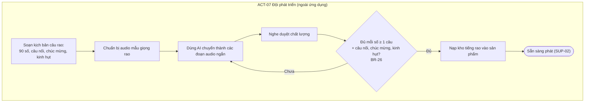

### FLOW-09 Chuẩn bị kho tiếng rao (BIZ-09)
- **Actor:** ACT-07 Đội phát triển · **Trigger:** Trước khi phát hành; khi muốn đổi bộ tiếng · **Kết quả:** Kho tiếng rao đầy đủ được nạp vào sản phẩm

- **Happy path:**
  1. Soạn kịch bản: câu rao cho từng số 1–90 (có thể nhiều câu/số), câu nối, câu chúc mừng người thắng, câu kinh hụt.
  2. Chuẩn bị audio mẫu giọng rao lô tô.
  3. Dùng AI tạo các đoạn audio ngắn theo kịch bản.
  4. Nghe duyệt chất lượng.
  5. Kiểm tra đủ theo BR-26.
  6. Nạp vào sản phẩm; từ đó FLOW-07/FLOW-08 phát được (SUP-02).
- **Alternative paths:**
  - A1. Đổi bộ tiếng sau phát hành: lặp lại 1–6; các phòng đang chơi dùng bộ mới từ số kế tiếp.
- **Exceptions:**
  - E1. Thiếu câu cho vài số nhưng vẫn phát hành: các số đó chỉ hiển thị, không phát tiếng (Q-029).
- **Supporting kích hoạt:** SUP-02 (tiêu thụ kho).
- **Business rules áp dụng:** BR-26 bước 5.
