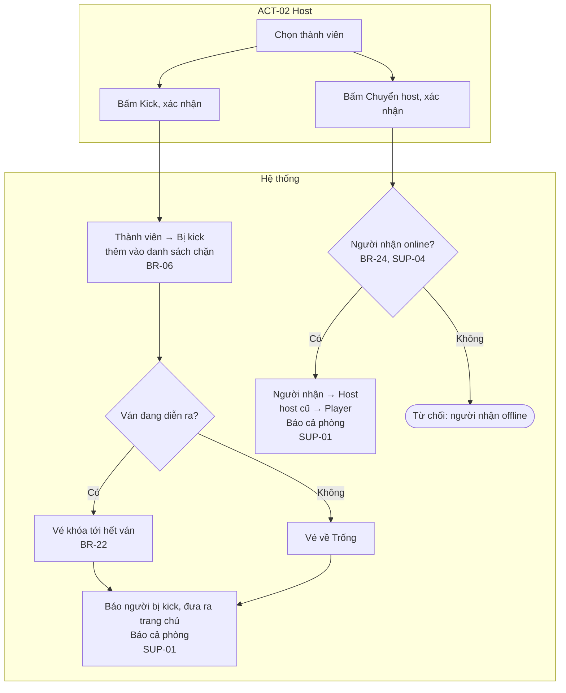

### FLOW-10 Quản lý thành viên (BIZ-10)
- **Actor:** ACT-02 Host, ACT-05 Hệ thống · **Trigger:** Host chọn một thành viên và bấm Kick / Chuyển host · **Kết quả:** Thành viên bị đưa ra và chặn, hoặc quyền host được chuyển

- **Happy path (kick):**
  1. Host chọn một thành viên (không phải chính mình) trong danh sách.
  2. Host bấm "Kick", xác nhận.
  3. Thành viên chuyển Bị kick, vào danh sách chặn của phòng (BR-06).
  4. Vé của họ: nếu ván đang diễn ra thì khóa tới hết ván rồi về Trống; nếu không thì về Trống ngay (BR-22).
  5. Người bị kick thấy "Bạn đã bị mời ra khỏi phòng", được đưa về trang chủ; cả phòng thấy (SUP-01).
- **Alternative paths:**
  - A1. Chuyển host: host chọn thành viên đang online, bấm "Chuyển host", xác nhận; người nhận thành Host, host cũ thành Player; cả phòng thấy (BR-24, SUP-01). Ván đang tạm dừng vì "chờ host" thì host mới điều khiển được ngay.
  - A2. Người bị kick đang offline: vẫn bị kick; thấy thông báo khi mở lại ứng dụng.
- **Exceptions:**
  - E1. Chuyển host cho người offline: từ chối (Q-029).
  - E2. Kick/chuyển host chính mình: không có nút.
- **Supporting kích hoạt:** SUP-01 tại bước 5, A1; SUP-04 tại A1.
- **Business rules áp dụng:** BR-06 bước 3; BR-22 bước 4; BR-24 tại A1, E1.
