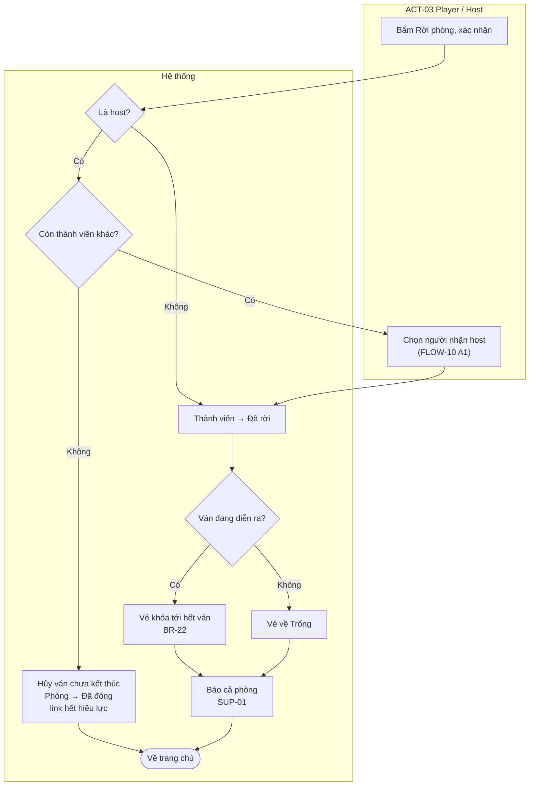

### FLOW-11 Rời phòng (BIZ-11)
- **Actor:** ACT-03 Player (gồm host), ACT-05 Hệ thống · **Trigger:** Bấm "Rời phòng" · **Kết quả:** Người dùng không còn ở phòng; người cuối rời thì phòng đóng

- **Happy path (player):**
  1. Player bấm "Rời phòng", xác nhận.
  2. Hệ thống kiểm tra vai trò: không phải host.
  3. Thành viên chuyển Đã rời.
  4. Vé: ván đang diễn ra thì khóa tới hết ván rồi về Trống; không thì về Trống ngay (BR-22).
  5. Cả phòng thấy "<tên> đã rời phòng" (SUP-01).
  6. Người rời về trang chủ, có thể tạo/vào phòng khác (BR-02).
- **Alternative paths:**
  - A1. Host rời khi còn thành viên khác: bắt buộc chọn người nhận host đang online trước (FLOW-10 A1), rồi tiếp bước 3 (BR-21).
  - A2. Người cuối cùng rời (host một mình): hủy ván chưa kết thúc, phòng Đã đóng, link mời hết hiệu lực (BR-21).
  - A3. Người đã rời muốn quay lại: dùng link còn hạn (FLOW-03 A2, BR-25).
- **Exceptions:**
  - E1. Host còn thành viên khác nhưng tất cả đang offline: không cho rời; báo "Chờ có thành viên online để chuyển host, hoặc kick các thành viên còn lại" (Q-038, BR-21).
- **Supporting kích hoạt:** SUP-01 tại bước 5; SUP-03 hủy hẹn giờ tại A2.
- **Business rules áp dụng:** BR-21 tại A1, A2; BR-22 bước 4; BR-02 bước 6; BR-25 tại A3.
