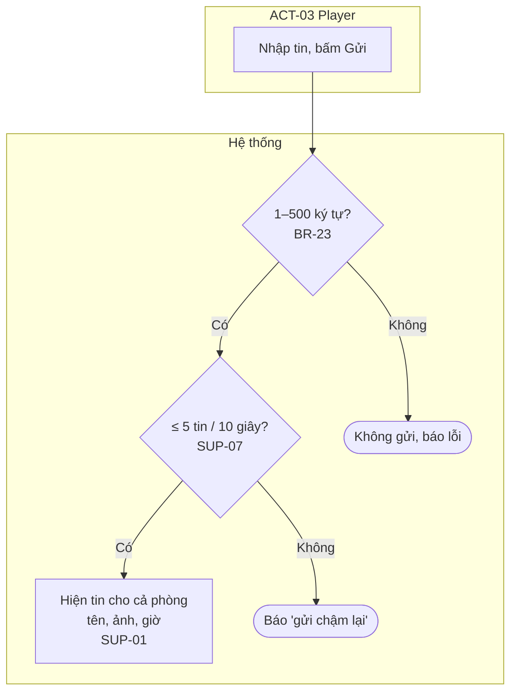
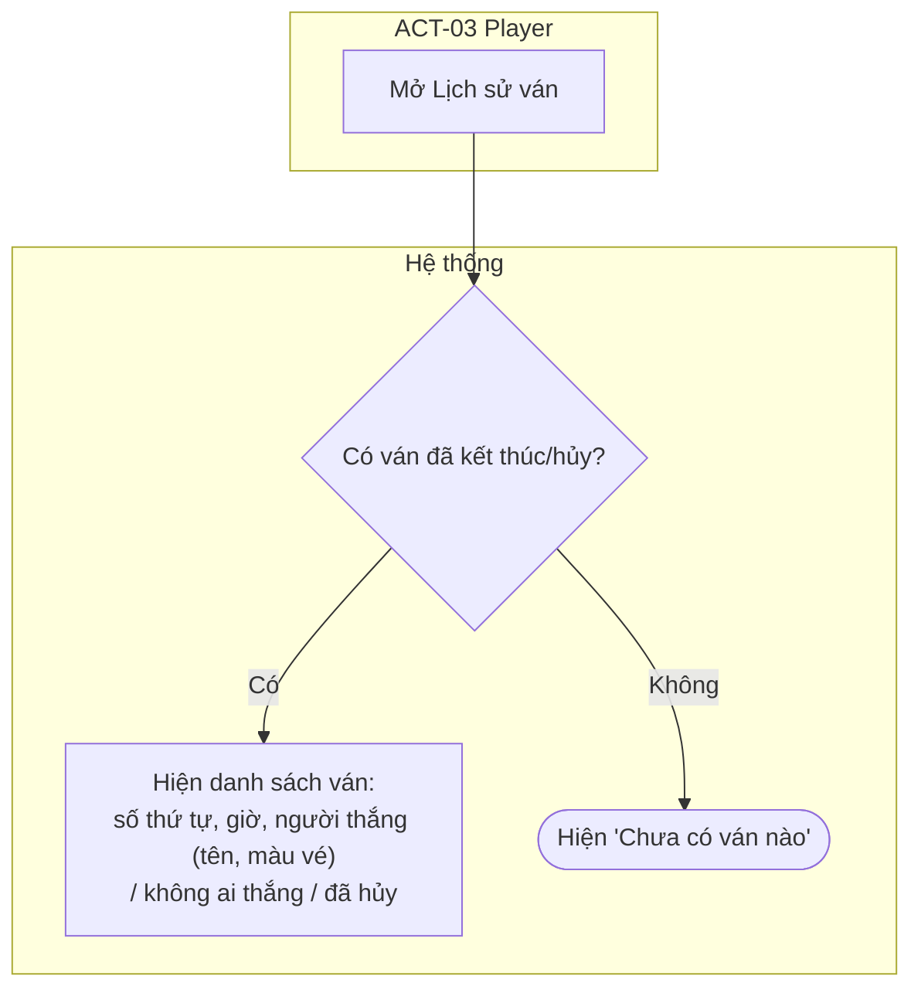
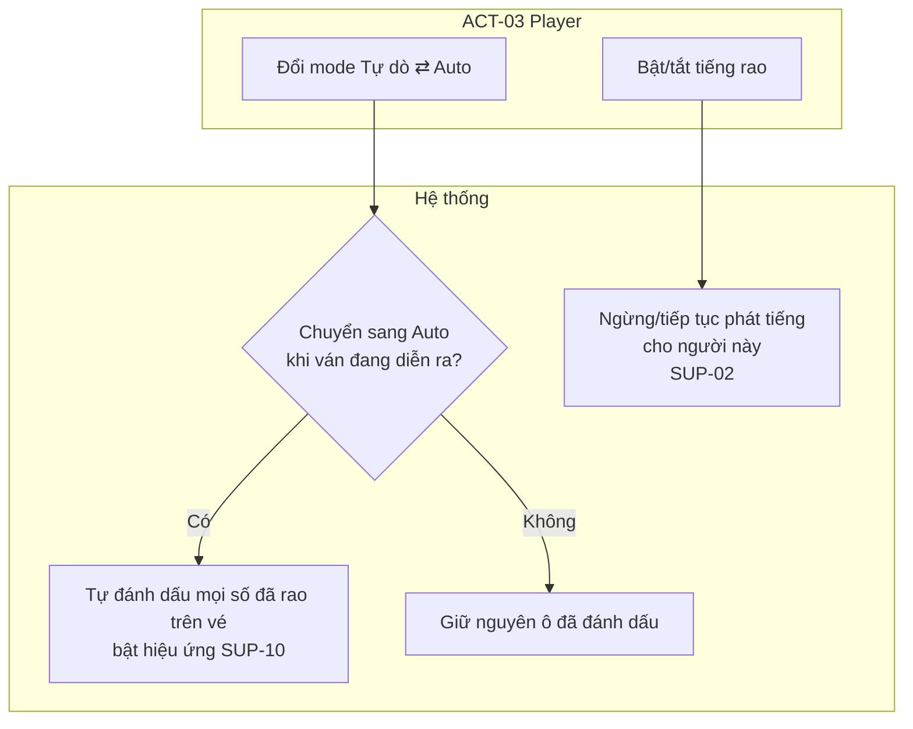
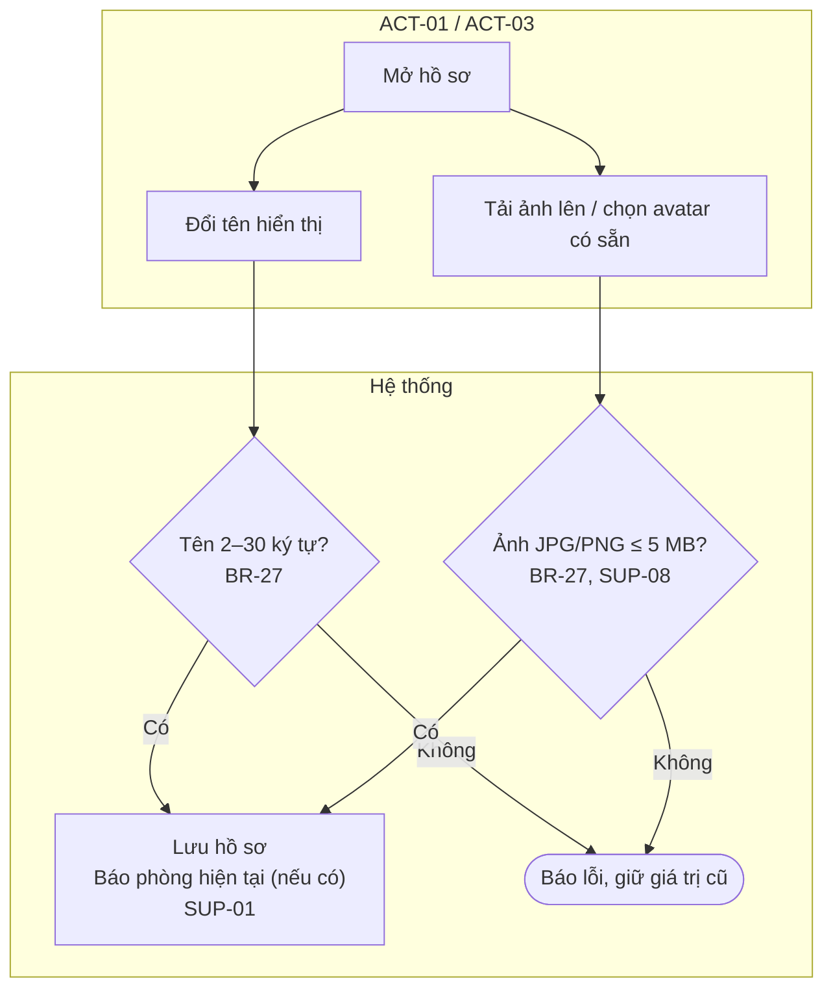

### FLOW-12 Chat trong phòng (BIZ-12)
- **Actor:** ACT-03 Player, ACT-05 Hệ thống · **Trigger:** Gửi tin nhắn · **Kết quả:** Tin nhắn hiện cho cả phòng

- **Happy path:** 1. Player nhập tin (text/emoji), bấm Gửi. 2. Kiểm tra 1–500 ký tự (BR-23). 3. Kiểm tra không quá 5 tin/10 giây (SUP-07). 4. Cả phòng thấy tin kèm tên, ảnh, giờ (SUP-01).
- **Alternative paths:** A1. Người mới vào phòng xem được toàn bộ tin cũ (BR-23). A2. Chat được cả khi ván đang chạy.
- **Exceptions:** E1. Rỗng hoặc > 500 ký tự: không gửi. E2. Quá 5 tin/10 giây: báo "Bạn gửi quá nhanh", giữ nội dung trong ô nhập. E3. Phòng đã đóng: ô chat bị khóa.
- **Supporting kích hoạt:** SUP-07 bước 3; SUP-01 bước 4.
- **Business rules áp dụng:** BR-23 bước 2, 3.

### FLOW-13 Xem lịch sử ván (BIZ-13)
- **Actor:** ACT-03 Player · **Trigger:** Mở "Lịch sử ván" · **Kết quả:** Danh sách ván và người thắng

- **Happy path:** 1. Player mở "Lịch sử ván". 2. Hệ thống lấy các ván Kết thúc/Đã hủy của phòng. 3. Hiện danh sách mới nhất trước: số thứ tự, giờ bắt đầu/kết thúc, người thắng (tên, màu vé) hoặc "Không ai thắng"/"Đã hủy" (Q-031).
- **Alternative paths:** A1. Ván mới kết thúc: lịch sử tự cập nhật (SUP-01). A2. Phòng đã đóng: không xem được nữa (Q-039).
- **Exceptions:** E1. Chưa có ván nào: hiện trống.
- **Supporting kích hoạt:** SUP-01 tại A1.
- **Business rules áp dụng:** —

### FLOW-15 Cài đặt cá nhân trong phòng (BIZ-15)
- **Actor:** ACT-03 Player · **Trigger:** Đổi mode dò / bật-tắt tiếng · **Kết quả:** Áp dụng ngay cho người đó

- **Happy path:** 1. Player đổi mode. 2. Nếu chuyển sang Auto trong ván: mọi số đã rao trên vé được tự đánh dấu, bật hiệu ứng (BR-20, SUP-10). 3. Bật/tắt tiếng: áp dụng ngay, chỉ cho người đó (SUP-02).
- **Alternative paths:** A1. Chuyển Auto → Tự dò: giữ các ô đã đánh dấu, tắt hiệu ứng. A2. Cài đặt giữ nguyên qua các ván trong phòng.
- **Exceptions:** —
- **Supporting kích hoạt:** SUP-10 bước 2; SUP-02 bước 3.
- **Business rules áp dụng:** BR-20.

### FLOW-16 Cập nhật hồ sơ cá nhân (BIZ-16)
- **Actor:** ACT-01/ACT-03 · **Trigger:** Mở hồ sơ, đổi tên/ảnh · **Kết quả:** Tên/ảnh mới dùng ở mọi phòng

- **Happy path:** 1. Mở hồ sơ. 2. Đổi tên hiển thị và/hoặc ảnh (tải lên hoặc chọn avatar có sẵn). 3. Kiểm tra theo BR-27. 4. Lưu; nếu đang ở phòng, thành viên khác thấy tên/ảnh mới (SUP-01).
- **Alternative paths:** A1. Khôi phục tên/ảnh từ Google.
- **Exceptions:** E1. Tên không hợp lệ hoặc ảnh sai định dạng/quá lớn: báo lỗi, giữ giá trị cũ.
- **Supporting kích hoạt:** SUP-08 bước 2; SUP-01 bước 4.
- **Business rules áp dụng:** BR-27 bước 3.
