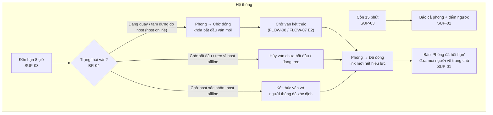

### FLOW-14 Hết hạn & đóng phòng (BIZ-14)
- **Actor:** ACT-05 Hệ thống (chính), ACT-03 (nhận thông báo) · **Trigger:** Thời gian (còn 15 phút; đến hạn 8 giờ); ván kết thúc khi phòng Chờ đóng · **Kết quả:** Phòng Đã đóng

- **Happy path:**
  1. Còn 15 phút: cả phòng thấy cảnh báo và đếm ngược (SUP-03, SUP-01).
  2. Đến hạn 8 giờ: hệ thống xem trạng thái ván (BR-04).
  3. Ván ở Chờ bắt đầu: hủy ván, sang bước 5.
  4. Ván Đang quay hoặc Tạm dừng do host (host vẫn online): phòng Chờ đóng, không cho bắt đầu ván mới; khi ván kết thúc thì sang bước 5 (Q-028, Q-029).
  5. Phòng Đã đóng; mọi link mời hết hiệu lực; hủy hẹn giờ còn lại.
  6. Mọi thành viên thấy "Phòng đã hết hạn", được đưa về trang chủ, có thể tạo/vào phòng khác (BR-02).
- **Alternative paths:**
  - A1. Ván treo vì host offline (Tạm dừng – chờ host) lúc đến hạn: hủy ván, đóng ngay (Q-021).
  - A2. Ván Chờ host xác nhận mà host offline lúc đến hạn: ván Kết thúc với người thắng đã xác định, lưu lịch sử, rồi đóng phòng (Q-042, BR-28).
  - A3. Phòng đóng sớm do người cuối cùng rời (FLOW-11 A2).
- **Exceptions:**
  - E1. Thành viên offline lúc đóng: khi mở lại ứng dụng thấy thông báo phòng đã hết hạn.
- **Supporting kích hoạt:** SUP-03 bước 1, 2; SUP-01 bước 1, 6.
- **Business rules áp dụng:** BR-04 bước 2–4; BR-05 bước 5; BR-28 tại A2.
