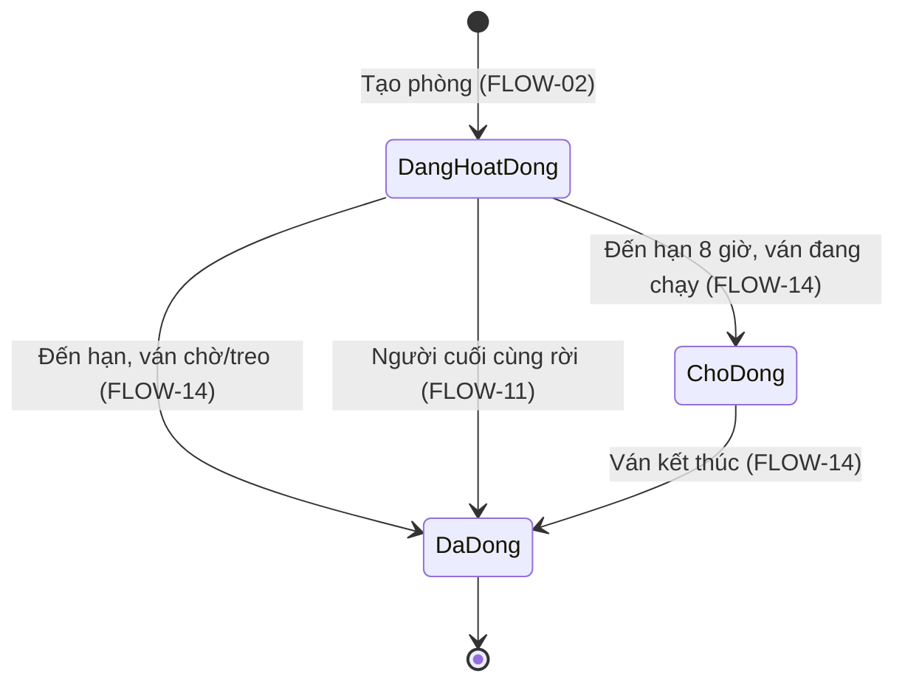
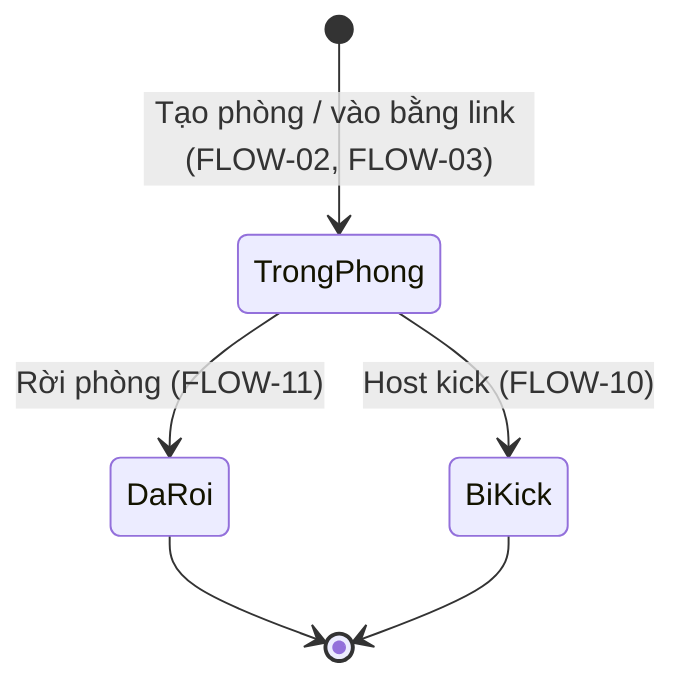
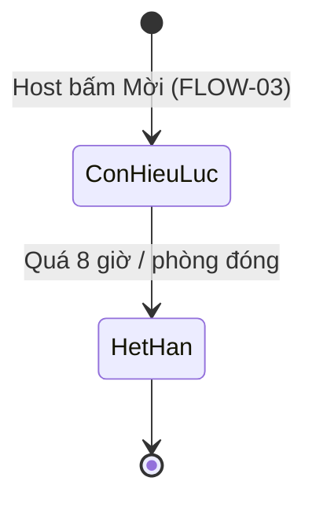
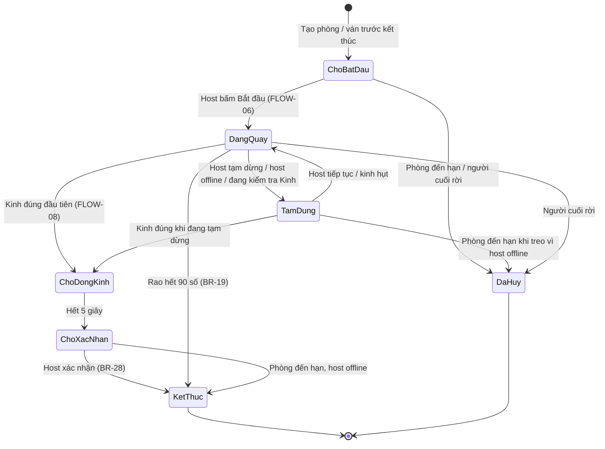
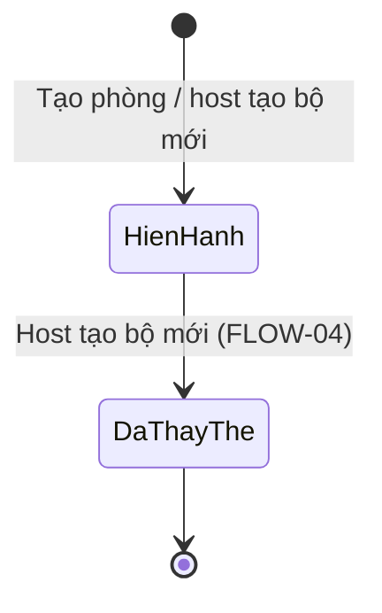
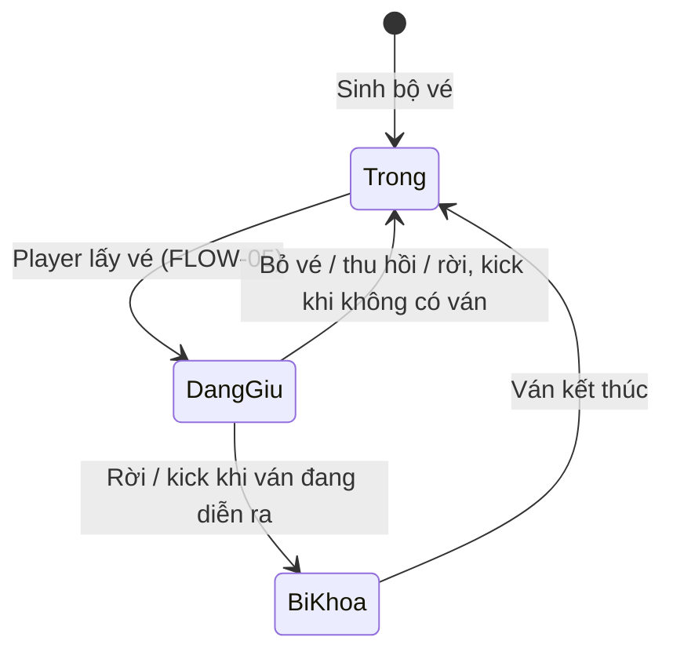
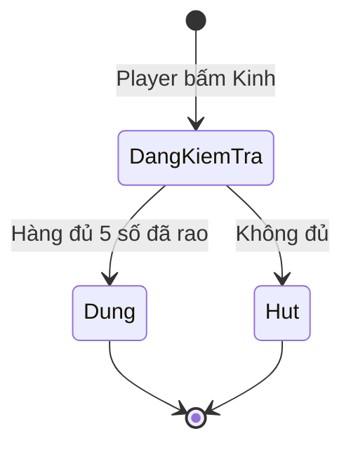

### Vòng đời entity

#### ENT-02 Phòng

| Trạng thái | → Trạng thái | Do FLOW/bước | Actor |
|---|---|---|---|
| — | Đang hoạt động | FLOW-02 bước 3 | ACT-01 |
| Đang hoạt động | Chờ đóng | FLOW-14 bước 4 | ACT-05 |
| Đang hoạt động | Đã đóng | FLOW-14 bước 3, A1, A2; FLOW-11 A2 | ACT-05 / ACT-02 |
| Chờ đóng | Đã đóng | FLOW-14 bước 4→5 | ACT-05 |

#### ENT-03 Thành viên phòng

Ghi chú: Online/offline là thuộc tính song song (SUP-04), không phải trạng thái vòng đời. Vai trò Host ⇄ Player đổi qua FLOW-10 A1. Người Đã rời vào lại = lần tham gia mới (FLOW-03 A2).

| Trạng thái | → Trạng thái | Do FLOW/bước | Actor |
|---|---|---|---|
| — | Trong phòng | FLOW-02 bước 4; FLOW-03 bước 12 | ACT-01 / ACT-04 |
| Trong phòng | Đã rời | FLOW-11 bước 3 | ACT-03 |
| Trong phòng | Bị kick | FLOW-10 bước 3 | ACT-02 |
| Trong phòng | (kết thúc khi phòng đóng) | FLOW-14 bước 6; FLOW-11 A2 | ACT-05 |

#### ENT-04 Link mời

| Trạng thái | → Trạng thái | Do FLOW/bước | Actor |
|---|---|---|---|
| — | Còn hiệu lực | FLOW-03 bước 2 | ACT-02 |
| Còn hiệu lực | Hết hạn | SUP-03 (8 giờ); FLOW-14 bước 5; FLOW-11 A2 | ACT-05 |

#### ENT-05 Ván

| Trạng thái | → Trạng thái | Do FLOW/bước | Actor |
|---|---|---|---|
| — | Chờ bắt đầu | FLOW-02 bước 6; FLOW-08 bước 9; FLOW-07 E3 | ACT-05 |
| Chờ bắt đầu | Đang quay | FLOW-06 bước 3 | ACT-02 |
| Đang quay | Tạm dừng | FLOW-06 A1, A4; FLOW-08 bước 4 | ACT-02 / ACT-05 |
| Tạm dừng | Đang quay | FLOW-06 A2; FLOW-08 E3 | ACT-02 / ACT-05 |
| Đang quay / Tạm dừng | Đang chờ đồng kinh | FLOW-08 bước 6, A1 | ACT-05 |
| Đang chờ đồng kinh | Chờ host xác nhận | FLOW-08 bước 7 | ACT-05 |
| Chờ host xác nhận | Kết thúc | FLOW-08 bước 7b; FLOW-14 A2 | ACT-02 / ACT-05 |
| Đang quay | Kết thúc (không người thắng) | FLOW-07 E2 | ACT-05 |
| Chờ bắt đầu / Tạm dừng / Đang quay | Đã hủy | FLOW-14 bước 3, A1; FLOW-11 A2 | ACT-05 |

#### ENT-06 Bộ vé

| Trạng thái | → Trạng thái | Do FLOW/bước | Actor |
|---|---|---|---|
| — | Hiện hành | FLOW-02 bước 5; FLOW-04 bước 4 | ACT-05 |
| Hiện hành | Đã thay thế | FLOW-04 bước 4 | ACT-02 |

#### ENT-07 Vé

| Trạng thái | → Trạng thái | Do FLOW/bước | Actor |
|---|---|---|---|
| — | Trống | FLOW-02 bước 5; FLOW-04 bước 4 | ACT-05 |
| Trống | Đang giữ | FLOW-05 bước 5 | ACT-03 |
| Đang giữ | Trống | FLOW-05 A1; FLOW-04 A1, A2; FLOW-10 bước 4; FLOW-11 bước 4 | ACT-03 / ACT-02 |
| Đang giữ | Bị khóa | FLOW-10 bước 4; FLOW-11 bước 4 (ván đang diễn ra) | ACT-02 / ACT-03 |
| Bị khóa | Trống | FLOW-08 bước 7b; FLOW-07 E2 | ACT-05 |

Ghi chú: trạng thái "Bị khóa" làm rõ BR-22 (vé của người rời/bị kick giữa ván) – bổ sung so với vòng đời ở business.md.

#### ENT-11 Lượt báo Kinh

| Trạng thái | → Trạng thái | Do FLOW/bước | Actor |
|---|---|---|---|
| — | Đang kiểm tra | FLOW-08 bước 2 | ACT-03 |
| Đang kiểm tra | Đúng | FLOW-08 bước 5–6, A2 | ACT-05 |
| Đang kiểm tra | Hụt | FLOW-08 E2 | ACT-05 |
