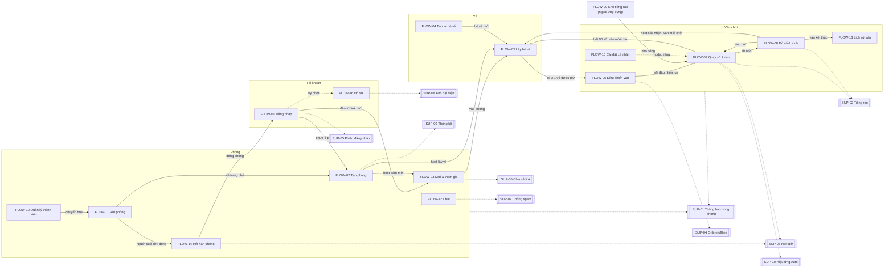

## 2. Flow tổng thể (Overview)
Hành trình end-to-end: người dùng đăng nhập Google → tạo phòng (thành host) → mời bạn qua link → bạn bè đăng nhập và vào phòng → mọi người lấy vé → host bắt đầu ván → hệ thống quay số và rao → player dò vé, bấm Kinh → hết cửa sổ đồng kinh, host xác nhận → ván kết thúc, ván mới chờ bắt đầu → lặp lại tới khi phòng hết hạn 8 giờ hoặc mọi người rời.

| Từ | Đến | Loại | Điều kiện |
|---|---|---|---|
| FLOW-01 | FLOW-02 | kích hoạt | Đăng nhập xong, không ở phòng nào, không đến từ link mời |
| FLOW-01 | FLOW-03 | kích hoạt | Đến từ link mời |
| FLOW-01 | FLOW-16 | tùy chọn | Người dùng mở hồ sơ |
| FLOW-02 | FLOW-03 | kích hoạt | Host bấm Mời |
| FLOW-02 / FLOW-03 | FLOW-05 | kích hoạt | Vào phòng, ván Chờ bắt đầu, còn vé |
| FLOW-04 | FLOW-05 | kích hoạt | Bộ vé mới, mọi vé trống |
| FLOW-05 | FLOW-06 | tiên quyết | Có ≥ 1 vé được giữ (BR-14) |
| FLOW-06 | FLOW-07 | kích hoạt | Host bấm Bắt đầu/Tiếp tục |
| FLOW-07 | FLOW-08 | kích hoạt | Có số mới, player dò vé |
| FLOW-08 | FLOW-07 | kích hoạt | Kinh hụt → quay tiếp |
| FLOW-08 | FLOW-05 | kích hoạt | Host xác nhận, ván mới Chờ bắt đầu |
| FLOW-07 | FLOW-05 | kích hoạt | Hết 90 số không ai kinh, ván mới Chờ bắt đầu |
| FLOW-08 / FLOW-07 | FLOW-13 | kích hoạt | Ván Kết thúc được ghi lịch sử |
| FLOW-09 | FLOW-07, FLOW-08 | tiên quyết | Kho tiếng rao đã nạp |
| FLOW-15 | FLOW-07, FLOW-08 | song song | Mode dò, bật/tắt tiếng áp dụng ngay |
| FLOW-12 | — | song song | Chat bất kỳ lúc nào khi phòng chưa đóng |
| FLOW-10 | FLOW-11 | tiên quyết | Host muốn rời khi còn người khác: chuyển host trước |
| FLOW-11 | FLOW-14 | kích hoạt | Người cuối cùng rời → đóng phòng |
| FLOW-14 | FLOW-01 / trang chủ | kích hoạt | Phòng đóng, mọi người về trang chủ |
| FLOW-11 | FLOW-02 / FLOW-03 | tùy chọn | Đã rời, có thể tạo/vào phòng khác |

### Hành trình theo actor
- **Host (ACT-02):** FLOW-01 Đăng nhập → FLOW-02 Tạo phòng → FLOW-03 Mời → FLOW-05 Lấy vé → FLOW-06 Bắt đầu → (FLOW-07 ⇄ FLOW-08) → FLOW-08 Xác nhận kết thúc → FLOW-06 Bắt đầu ván tiếp… → [FLOW-04 Tạo lại bộ vé] → [FLOW-10 Kick/chuyển host] → FLOW-11 Rời / FLOW-14 Hết hạn.
- **Khách → Player (ACT-04 → ACT-03):** Nhận link → FLOW-01 Đăng nhập → FLOW-03 Vào phòng → FLOW-05 Lấy vé (hoặc chờ nếu hết vé) → FLOW-15 Chọn mode/tiếng → FLOW-07 Nghe rao → FLOW-08 Dò & Kinh → FLOW-13 Xem lịch sử → FLOW-12 Chat (suốt quá trình) → FLOW-11 Rời / FLOW-14 Hết hạn.
- **Hệ thống (ACT-05):** FLOW-02 sinh vé & ván → FLOW-07 quay số → FLOW-08 kiểm tra Kinh → FLOW-14 hết hạn.
- **Đội phát triển (ACT-07):** FLOW-09 (trước phát hành).

### Kiểm tra
- Điểm bắt đầu: FLOW-01, FLOW-09. Không có FLOW mồ côi.
- Vòng lặp chính FLOW-05 → FLOW-06 → FLOW-07 ⇄ FLOW-08 → FLOW-05 có điểm thoát: FLOW-14 (hết hạn 8 giờ) và FLOW-11 (rời phòng). Không phải vòng lặp vô hạn.
- FLOW-13, FLOW-12, FLOW-16 là kết thúc tự nhiên (xem/gửi/sửa).
