# Business Flows: Lô Tô Online

> Nguồn: `idea/business.md` · Nhật ký: `idea/_qa-log.md` (Q-030..Q-041) · Cập nhật: 2026-11-18

## 1. Nghiệp vụ phụ trợ (Supporting)
| ID | Tên | Loại | Kích hoạt bởi | Người nhận / tác động | Ghi chú |
|---|---|---|---|---|---|
| SUP-01 | Thông báo trong phòng (real-time) | notification (in-app) | BIZ-03 (người vào), BIZ-04 (bộ vé mới), BIZ-05 (lấy/bỏ vé), BIZ-06 (trạng thái ván), BIZ-08 (kinh hụt, người thắng), BIZ-10 (kick, đổi host), BIZ-11 (người rời), BIZ-12 (tin nhắn), BIZ-14 (cảnh báo 15 phút, đóng phòng), BIZ-16 (đổi tên/ảnh) | Mọi thành viên đang trong phòng; riêng người bị kick nhận thông báo cá nhân | Hiển thị ngay khi sự kiện xảy ra, không cần tải lại |
| SUP-02 | Phát tiếng rao | audio | BIZ-07 (rao số, câu nối), BIZ-08 (kinh hụt, chúc mừng) | Thành viên đang bật tiếng | Lấy từ kho tiếng rao (ENT-09); mỗi số nhiều câu thì chọn ngẫu nhiên; thiếu câu thì chỉ hiển thị số (BR-26) |
| SUP-03 | Hẹn giờ | scheduler (phía thiết bị) | BIZ-07 (mỗi N giây), BIZ-08 (cửa sổ đồng kinh 5 giây), BIZ-14 (còn 15 phút, đến hạn 8 giờ), BIZ-03 (link hết hạn 8 giờ) | Ván, phòng, link mời | Thiết bị người chơi đếm giờ và báo hệ thống; hệ thống kiểm thời điểm bằng giờ của mình (Q-051) |
| SUP-04 | Theo dõi online/offline | presence | Mọi thành viên kết nối/mất kết nối | BIZ-04 (thu hồi vé người offline); hiển thị ai online trong phòng | Danh sách thành viên hiển thị trạng thái online/offline |
| SUP-05 | Phiên đăng nhập | auth | BIZ-01 | Người dùng | Giữ đăng nhập giữa các lần mở; đăng xuất; sau đăng nhập quay về đúng link mời đang mở |
| SUP-06 | Chia sẻ link mời | share | BIZ-03 | Host; người nhận link trên Messenger/Telegram/Zalo | Nút chia sẻ của thiết bị + copy link; khi dán link vào ứng dụng chat hiện thẻ xem trước (tên phòng, tên host, ảnh) |
| SUP-07 | Chống spam chat | rate limit | BIZ-12 | Người gửi | Tối đa 5 tin / 10 giây / người; vượt thì báo "gửi chậm lại" (BR-23) |
| SUP-08 | Lưu ảnh đại diện | file | BIZ-16 | Người dùng | Ảnh tải lên JPG/PNG ≤ 5 MB; bộ avatar có sẵn |
| SUP-09 | Thống kê vận hành | report | Tổng hợp hằng ngày từ BIZ-01, BIZ-02, BIZ-03, BIZ-06, BIZ-08 | Đội phát triển (ACT-07), xem ngoài ứng dụng | Người dùng mới/ngày, người chơi hoạt động/ngày, số phòng/ngày, số ván/ngày, số người trung bình/phòng |
| SUP-10 | Hiệu ứng vé mode Auto | UX feedback | BIZ-07 | Player để mode Auto | Số vừa rao có trên vé thì nổi bật (nhấp nháy/rung); hàng còn thiếu 1 số đánh dấu "chờ" (BR-20) |

**Ngoài phạm vi MVP:**
- SUP-11 Nhật ký diễn biến ván — Chỉ lưu người thắng mỗi ván (BIZ-13) (Q-030, Q-031)
- SUP-12 Thông báo ngoài ứng dụng (push) — không làm (Q-030)
- SUP-13 Đa ngôn ngữ — Chỉ tiếng Việt (Q-030)
- SUP-14 Thanh toán / điểm thưởng — Giải trí thuần (Q-019)

## 2. Flow tổng thể (Overview)
Hành trình end-to-end: người dùng đăng nhập Google → tạo phòng (thành host) → mời bạn qua link → bạn bè đăng nhập và vào phòng → mọi người lấy vé → host bắt đầu ván → hệ thống quay số và rao → player dò vé, bấm Kinh → hết cửa sổ đồng kinh, host xác nhận → ván kết thúc, ván mới chờ bắt đầu → lặp lại tới khi phòng hết hạn 8 giờ hoặc mọi người rời.

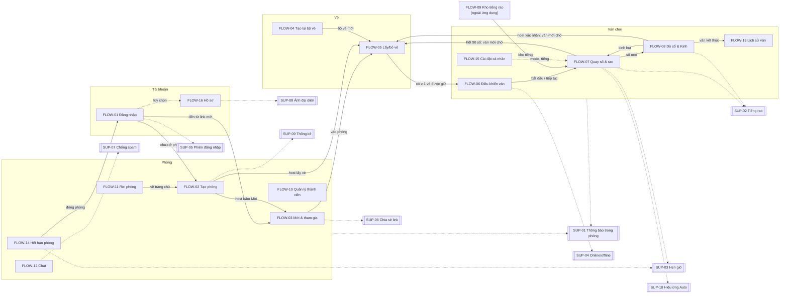

| Từ | Đến | Loại | Điều kiện |
|---|---|---|---|
| FLOW-01 | FLOW-02 | kích hoạt | Đăng nhập xong, không ở phòng nào, không đến từ link mời |
| FLOW-01 | FLOW-03 | kích hoạt | Đến từ link mời |
| FLOW-01 | FLOW-16 | tùy chọn | Người dùng mở hồ sơ |
| FLOW-02 | FLOW-03 | kích hoạt | Host bấm Mời |
| FLOW-02 / FLOW-03 | FLOW-05 | kích hoạt | Vào phòng, ván Chờ bắt đầu, còn vé |
| FLOW-04 | FLOW-05 | kích hoạt | Bộ vé mới, mọi vé trống |
| FLOW-05 | FLOW-06 | tiên quyết | Có ≥ 1 vé được giữ (BR-14) |
| FLOW-06 | FLOW-07 | kích hoạt | Host bấm Bắt đầu/Tiếp tục |
| FLOW-07 | FLOW-08 | kích hoạt | Có số mới, player dò vé |
| FLOW-08 | FLOW-07 | kích hoạt | Kinh hụt → quay tiếp |
| FLOW-08 | FLOW-05 | kích hoạt | Host xác nhận, ván mới Chờ bắt đầu |
| FLOW-07 | FLOW-05 | kích hoạt | Hết 90 số không ai kinh, ván mới Chờ bắt đầu |
| FLOW-08 / FLOW-07 | FLOW-13 | kích hoạt | Ván Kết thúc được ghi lịch sử |
| FLOW-09 | FLOW-07, FLOW-08 | tiên quyết | Kho tiếng rao đã nạp |
| FLOW-15 | FLOW-07, FLOW-08 | song song | Mode dò, bật/tắt tiếng áp dụng ngay |
| FLOW-12 | — | song song | Chat bất kỳ lúc nào khi phòng chưa đóng |
| FLOW-10 | — | kết thúc | Player bị kick về trang chủ |
| FLOW-14 | FLOW-01 / trang chủ | kích hoạt | Phòng đóng, mọi người về trang chủ |
| FLOW-11 | FLOW-02 / FLOW-03 | tùy chọn | Đã rời, có thể tạo/vào phòng khác |

### Hành trình theo actor
- **Host (ACT-02):** FLOW-01 Đăng nhập → FLOW-02 Tạo phòng → FLOW-03 Mời → FLOW-05 Lấy vé → FLOW-06 Bắt đầu → (FLOW-07 ⇄ FLOW-08) → FLOW-08 Xác nhận kết thúc → FLOW-06 Bắt đầu ván tiếp… → [FLOW-04 Tạo lại bộ vé] → [FLOW-10 Kick player] → FLOW-14 Hết hạn (host không rời phòng).
- **Khách → Player (ACT-04 → ACT-03):** Nhận link → FLOW-01 Đăng nhập → FLOW-03 Vào phòng → FLOW-05 Lấy vé (hoặc chờ nếu hết vé) → FLOW-15 Chọn mode/tiếng → FLOW-07 Nghe rao → FLOW-08 Dò & Kinh → FLOW-13 Xem lịch sử → FLOW-12 Chat (suốt quá trình) → FLOW-11 Rời / FLOW-14 Hết hạn.
- **Hệ thống (ACT-05):** FLOW-02 sinh vé & ván → FLOW-07 quay số → FLOW-08 kiểm tra Kinh → FLOW-14 hết hạn.
- **Đội phát triển (ACT-07):** FLOW-09 (trước phát hành).

### Kiểm tra
- Điểm bắt đầu: FLOW-01, FLOW-09. Không có FLOW mồ côi.
- Vòng lặp chính FLOW-05 → FLOW-06 → FLOW-07 ⇄ FLOW-08 → FLOW-05 có điểm thoát: FLOW-14 (hết hạn 8 giờ) và FLOW-11 (rời phòng). Không phải vòng lặp vô hạn.
- FLOW-13, FLOW-12, FLOW-16 là kết thúc tự nhiên (xem/gửi/sửa).

## 3. Flows chi tiết

### FLOW-01 Đăng nhập bằng Google (BIZ-01)
- **Actor:** ACT-01/ACT-04, ACT-06 Google, ACT-05 Hệ thống · **Trigger:** Mở ứng dụng hoặc link mời khi chưa đăng nhập · **Kết quả:** Người dùng đã đăng nhập, được đưa tới đúng nơi

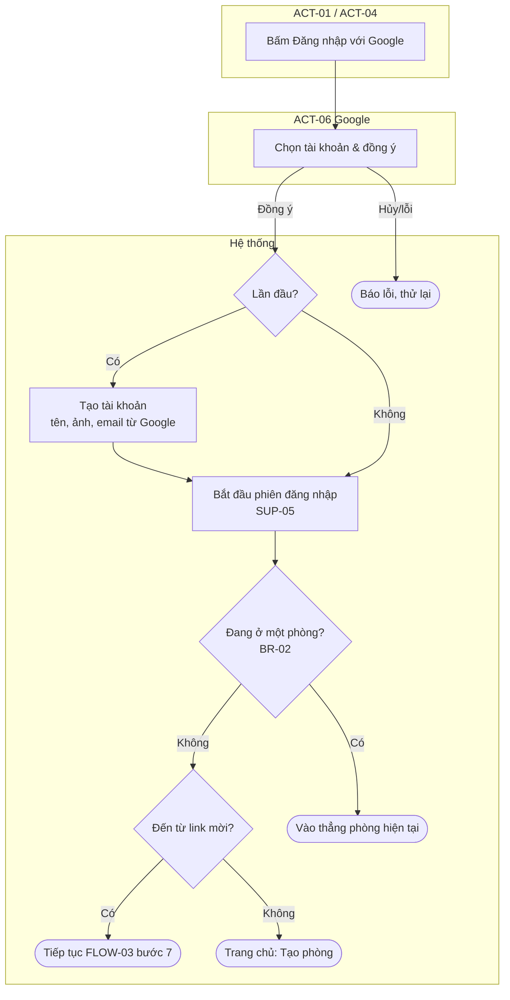

- **Happy path:**
  1. Người dùng bấm "Đăng nhập với Google" (BR-01).
  2. Google cho chọn tài khoản và đồng ý chia sẻ tên, ảnh, email.
  3. Hệ thống kiểm tra tài khoản đã tồn tại chưa.
  4. Lần đầu: tạo tài khoản với tên, ảnh, email từ Google.
  5. Bắt đầu phiên đăng nhập (SUP-05).
  6. Nếu đang ở một phòng còn hoạt động → vào thẳng phòng đó.
  7. Nếu đến từ link mời → tiếp tục FLOW-03 bước 7.
  8. Còn lại → trang chủ với nút "Tạo phòng".
- **Alternative paths:**
  - A1. Đã có phiên đăng nhập còn hiệu lực: bỏ qua bước 1–5, đi thẳng bước 6.
  - A2. Người dùng đăng xuất (cập nhật từ Phase 3 – Q-052): ván đang diễn ra → nút đăng xuất bị khóa. Player → đồng thời **rời phòng** (như FLOW-11). Host → **đóng phòng** cho mọi người (hủy ván chờ, mọi người về trang chủ).
  - A3. Người dùng đã tự đổi tên/ảnh (BIZ-16): đăng nhập lại không ghi đè bằng tên/ảnh Google.
- **Exceptions:**
  - E1. Người dùng hủy ở Google hoặc Google lỗi: báo "Đăng nhập không thành công, thử lại", ở lại màn đăng nhập.
  - E2. Đang mở trong trình duyệt của ứng dụng chat không cho đăng nhập Google: hiện hướng dẫn "Mở bằng trình duyệt" kèm nút copy link, giữ nguyên link mời (NFR-13).
- **Supporting kích hoạt:** SUP-05 tại bước 5; SUP-09 (đếm người dùng mới/hoạt động) tại bước 4–5.
- **Business rules áp dụng:** BR-01 bước 1; BR-02 bước 6.

### FLOW-02 Tạo phòng (BIZ-02)
- **Actor:** ACT-01 (trở thành ACT-02), ACT-05 Hệ thống · **Trigger:** Bấm "Tạo phòng" · **Kết quả:** Phòng mới với bộ vé và ván Chờ bắt đầu

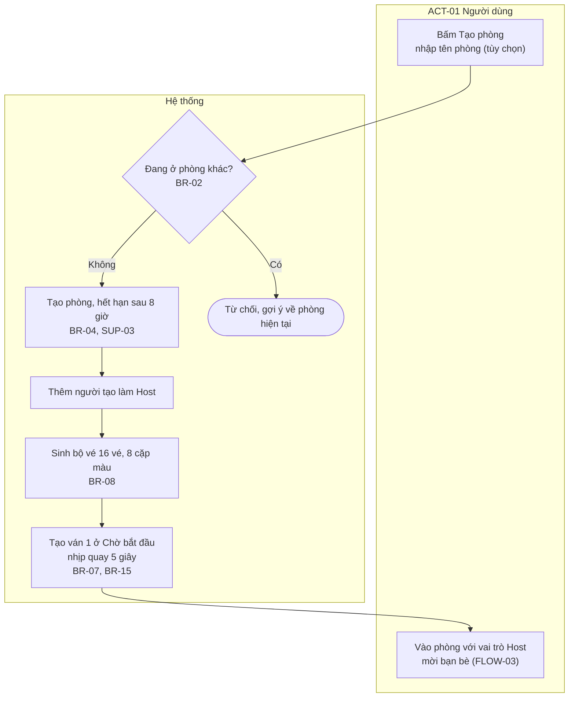

- **Happy path:**
  1. Người dùng bấm "Tạo phòng", có thể nhập tên; để trống thì dùng "Phòng của <tên>".
  2. Hệ thống kiểm tra người dùng không ở phòng nào (BR-02).
  3. Tạo phòng Đang hoạt động, hết hạn sau 8 giờ; đặt hẹn giờ cảnh báo 15 phút và đóng phòng (BR-04, SUP-03).
  4. Thêm người tạo làm thành viên vai trò Host.
  5. Sinh bộ vé 16 vé: 8 màu × 2 vé; mỗi vé 9 hàng × 9 cột, mỗi hàng 5 số; 2 vé cùng màu gộp đủ 1–90 (BR-08).
  6. Tạo ván số 1 ở Chờ bắt đầu, nhịp quay mặc định 5 giây (BR-07, BR-15).
  7. Host vào phòng, thấy bộ vé, nút Mời, nút Bắt đầu (bị khóa tới khi có vé được giữ).
- **Alternative paths:**
  - A1. Host lấy vé cho mình ngay (FLOW-05).
- **Exceptions:**
  - E1. Người dùng đang ở phòng khác: báo "Bạn đang ở phòng <tên>", có nút về phòng đó.
- **Supporting kích hoạt:** SUP-03 tại bước 3; SUP-09 (đếm phòng) tại bước 3.
- **Business rules áp dụng:** BR-02 bước 2; BR-04 bước 3; BR-08 bước 5; BR-07, BR-15 bước 6.

### FLOW-03 Mời & tham gia phòng (BIZ-03)
- **Actor:** ACT-02 Host, ACT-04 Khách / ACT-01 Người dùng, ACT-05 Hệ thống · **Trigger:** Host bấm "Mời"; khách mở link mời · **Kết quả:** Khách trở thành Player trong phòng

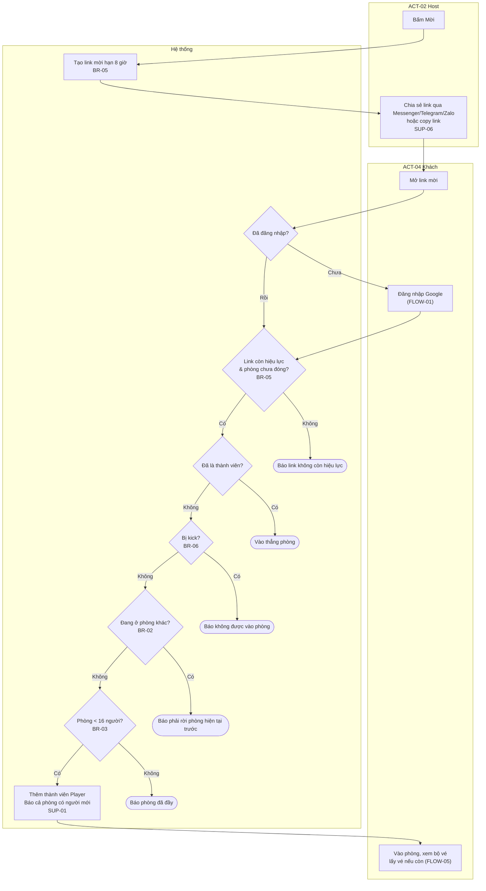

- **Happy path:**
  1. Host bấm "Mời".
  2. Hệ thống hiện link mời đã tạo sẵn cùng phòng, hết hạn cùng phòng (BR-05, cập nhật từ Phase 3 – Q-046).
  3. Host chia sẻ link bằng nút chia sẻ của thiết bị hoặc copy link; khi dán vào ứng dụng chat, link hiện thẻ xem trước gồm tên phòng, tên host, ảnh (SUP-06).
  4. Khách mở link.
  5. Hệ thống kiểm tra khách đã đăng nhập chưa.
  6. Chưa đăng nhập thì khách đăng nhập Google (FLOW-01); xong quay lại đúng link (SUP-05).
  7. Hệ thống kiểm tra link còn hiệu lực và phòng chưa đóng (BR-05).
  8. Kiểm tra khách chưa phải thành viên đang trong phòng.
  9. Kiểm tra khách không bị kick khỏi phòng này (BR-06).
  10. Kiểm tra khách không đang ở phòng khác (BR-02).
  11. Kiểm tra phòng còn dưới 16 người (BR-03).
  12. Thêm khách làm thành viên Player; cả phòng thấy "<tên> đã vào phòng" (SUP-01).
  13. Khách xem phòng, bộ vé, danh sách thành viên, chat; lấy vé nếu ván đang Chờ bắt đầu và còn vé (FLOW-05). Hết vé thì ở lại xem.
- **Alternative paths:**
  - A1. Khách đã là thành viên đang trong phòng (vd mở lại link): vào thẳng phòng, không thêm mới.
  - A2. Khách từng tự rời phòng: được vào lại như thành viên mới, không được trả vé cũ (BR-25).
  - A3. Khách vào khi ván đang chạy: xem ván, nghe rao, chat; không lấy vé tới khi ván kết thúc (BR-10).
  - A4. Host bấm "Mời" lần nữa: luôn hiện cùng một link, tạo sẵn lúc tạo phòng và hết hạn cùng phòng (cập nhật từ Phase 3 – Q-046).
- **Exceptions:**
  - E1. Link hết hạn hoặc phòng đã đóng: báo "Link không còn hiệu lực", đưa về trang chủ.
  - E2. Khách bị kick khỏi phòng: báo "Bạn không thể vào phòng này".
  - E3. Khách đang ở phòng khác: báo phải rời phòng hiện tại, có nút về phòng hiện tại.
  - E4. Phòng đủ 16 người: báo "Phòng đã đầy".
  - E5. Khách hủy đăng nhập Google: dừng, link vẫn mở lại được.
- **Supporting kích hoạt:** SUP-03 tại bước 2 (hẹn giờ hết hạn link); SUP-06 tại bước 3; SUP-05 tại bước 6; SUP-01 tại bước 12.
- **Business rules áp dụng:** BR-05 bước 2, 7; BR-06 bước 9; BR-02 bước 10; BR-03 bước 11; BR-10 tại A3; BR-25 tại A2.

### FLOW-04 Tạo lại bộ vé (BIZ-04)
- **Actor:** ACT-02 Host, ACT-05 Hệ thống · **Trigger:** Host bấm "Tạo bộ vé mới" · **Kết quả:** Bộ vé mới hiện hành, mọi vé trống

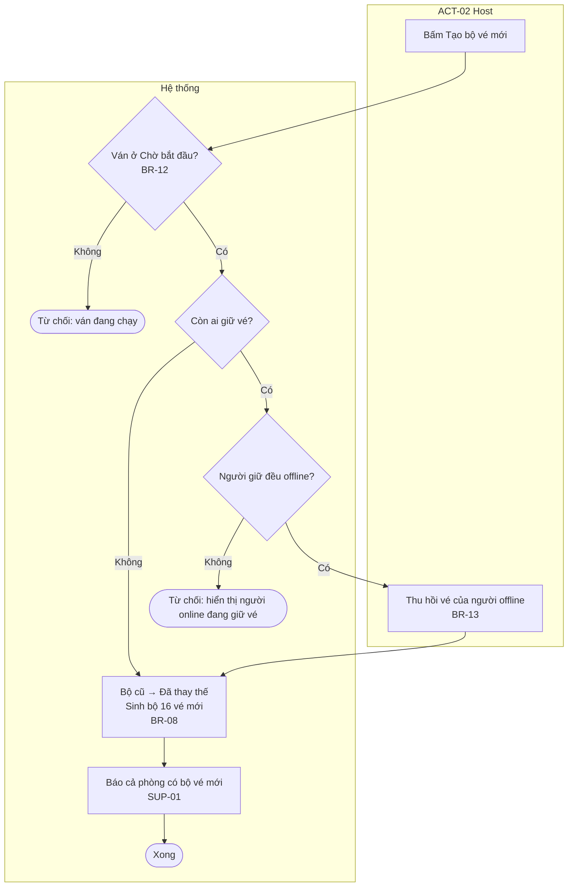

- **Happy path:**
  1. Host bấm "Tạo bộ vé mới".
  2. Hệ thống kiểm tra ván hiện tại ở Chờ bắt đầu (BR-12).
  3. Kiểm tra không còn ai giữ vé.
  4. Bộ vé cũ chuyển Đã thay thế; sinh bộ 16 vé mới (BR-08).
  5. Cả phòng thấy bộ vé mới (SUP-01).
- **Alternative paths:**
  - A1. Chỉ còn người offline giữ vé: hệ thống liệt kê họ, host bấm "Thu hồi vé"; vé về Trống, người đó thấy thông báo khi online lại (BR-13, SUP-04). Sau đó tiếp bước 4.
  - A2. Host thu hồi vé người offline mà không tạo bộ mới: vé về Trống, người khác lấy được.
- **Exceptions:**
  - E1. Ván đang chạy/tạm dừng/chờ xác nhận: từ chối.
  - E2. Còn người online giữ vé: từ chối, hiển thị ai đang giữ để host nhắc họ bỏ vé.
- **Supporting kích hoạt:** SUP-04 tại bước 3/A1; SUP-01 tại bước 5, A1.
- **Business rules áp dụng:** BR-12 bước 2–3; BR-13 tại A1, A2; BR-08 bước 4.

### FLOW-05 Lấy / bỏ vé (BIZ-05)
- **Actor:** ACT-03 Player (gồm host), ACT-05 Hệ thống · **Trigger:** Player chọn vé trống / bỏ vé đang giữ · **Kết quả:** Player giữ 0–2 vé

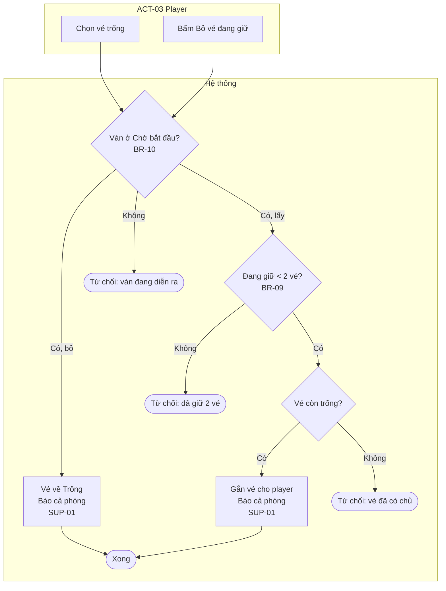

- **Happy path (lấy vé):**
  1. Player xem bộ vé: màu, vé đã có chủ (tên, ảnh), vé trống; chọn một vé trống.
  2. Hệ thống kiểm tra ván ở Chờ bắt đầu (BR-10).
  3. Kiểm tra player đang giữ dưới 2 vé (BR-09).
  4. Kiểm tra vé còn trống (người đến trước được).
  5. Gắn vé cho player; cả phòng thấy vé đã có chủ (SUP-01).
- **Alternative paths:**
  - A1. Bỏ vé: player bấm "Bỏ vé"; ván ở Chờ bắt đầu thì vé về Trống, cả phòng thấy (SUP-01).
  - A2. Hết vé trống: player ở lại xem, chờ người khác bỏ vé ở ván sau.
  - A3. Vé giữ từ ván trước: vẫn thuộc player, không cần lấy lại (BR-11).
- **Exceptions:**
  - E1. Ván đang chạy/tạm dừng/chờ xác nhận: nút lấy/bỏ bị khóa.
  - E2. Đã giữ 2 vé: báo "Tối đa 2 vé".
  - E3. Hai người cùng chọn một vé: người sau báo "Vé đã có người lấy".
- **Supporting kích hoạt:** SUP-01 tại bước 5, A1.
- **Business rules áp dụng:** BR-10 bước 2; BR-09 bước 3, 4; BR-11 tại A3.

### FLOW-06 Điều khiển ván (BIZ-06)
- **Actor:** ACT-02 Host, ACT-05 Hệ thống · **Trigger:** Host bấm Bắt đầu / Tạm dừng / Tiếp tục / đổi nhịp · **Kết quả:** Trạng thái ván cập nhật cho mọi người

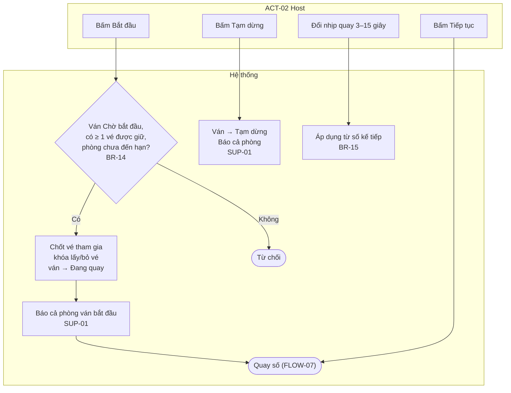

- **Happy path (bắt đầu):**
  1. Host bấm "Bắt đầu".
  2. Hệ thống kiểm tra: ván ở Chờ bắt đầu, có ít nhất 1 vé được giữ, phòng chưa đến hạn đóng (BR-14).
  3. Chốt danh sách vé tham gia (vé đang có người giữ); khóa lấy/bỏ vé; ván chuyển Đang quay.
  4. Cả phòng thấy "Ván <n> bắt đầu" (SUP-01).
  5. Quay số bắt đầu (FLOW-07).
- **Alternative paths:**
  - A1. Tạm dừng: host bấm "Tạm dừng" → ván Tạm dừng, cả phòng thấy (SUP-01); ngừng quay số.
  - A2. Tiếp tục: host bấm "Tiếp tục" → ván Đang quay, quay số tiếp (FLOW-07).
  - A3. Đổi nhịp: host chọn 3–15 giây; áp dụng từ số kế tiếp; cả phòng thấy nhịp mới (BR-15).
  - A4. Host mất kết nối: ván vẫn chạy bình thường (Q-048).
  - A5. Bắt đầu ván thứ 2 trở đi: giống bước 1–5, sau khi ván trước Kết thúc (FLOW-08).
- **Exceptions:**
  - E1. Không có vé nào được giữ: nút Bắt đầu bị khóa, gợi ý "Cần ít nhất 1 người lấy vé".
  - E2. Phòng Chờ đóng / sắp đến hạn đóng: không cho bắt đầu ván mới (BR-14).
  - E3. Người không phải host: không thấy nút điều khiển.
- **Supporting kích hoạt:** SUP-01 tại bước 4, A1, A3, A4; SUP-04 tại A4; SUP-03 tại bước 5 (bắt đầu đếm nhịp); SUP-09 (đếm ván) tại bước 3.
- **Business rules áp dụng:** BR-14 bước 2; BR-10 bước 3 (khóa vé); BR-15 tại A3; BR-16 tại A1, A4.

### FLOW-07 Quay số & rao (BIZ-07)
- **Actor:** ACT-05 Hệ thống (chính), ACT-03 Player (xem, nghe) · **Trigger:** Thời gian, mỗi N giây khi ván Đang quay — thiết bị host (dự phòng: lần lượt từng player theo vé nhỏ nhất, cách 5 giây – Q-052) báo tới nhịp (cập nhật từ Phase 3 – Q-051) · **Kết quả:** Số mới được công bố và rao

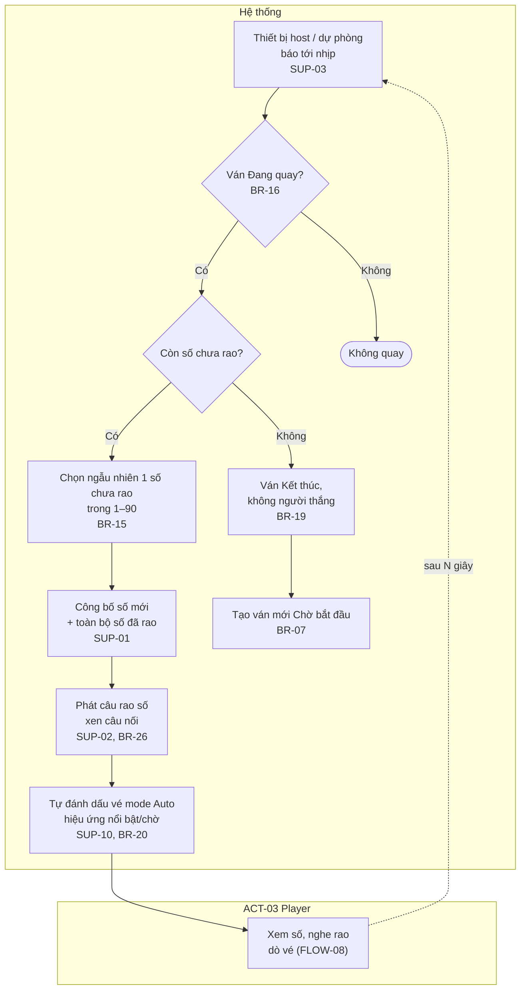

- **Happy path:**
  1. Số đầu tiên do hệ thống rao ngay khi host Bắt đầu. Các số sau: đến nhịp quay (N giây sau số trước), thiết bị host báo hệ thống; nếu chưa có số mới thì player thứ k (theo vé nhỏ nhất họ giữ: Đỏ A → Hồng B, trừ host) báo thay ở +5k giây, lần lượt tới player cuối. Hệ thống chỉ nhận báo đầu tiên và từ chối báo sớm hơn N giây (SUP-03) (cập nhật từ Phase 3 – Q-052).
  2. Hệ thống kiểm tra ván Đang quay (không tạm dừng, không đang kiểm tra Kinh/chờ đồng kinh/chờ xác nhận) (BR-16).
  3. Kiểm tra còn số chưa rao.
  4. Chọn ngẫu nhiên 1 số chưa rao trong 1–90 (BR-15).
  5. Mọi thành viên thấy số mới và toàn bộ số đã rao (SUP-01, BR-20).
  6. Phát câu rao cho số đó (chọn ngẫu nhiên nếu nhiều câu), xen câu nối giữa các số; người tắt tiếng không nghe (SUP-02, BR-26).
  7. Vé của player mode Auto được tự đánh dấu; số trúng nổi bật, hàng thiếu 1 số đánh dấu "chờ" (SUP-10, BR-20).
  8. Player xem số, nghe rao, dò vé, có thể bấm Kinh (FLOW-08). Lặp lại bước 1.
- **Alternative paths:**
  - A1. Số không có câu rao trong kho: chỉ hiển thị số, không phát tiếng (Q-029).
  - A2. Host đổi nhịp giữa chừng: nhịp mới tính từ số kế tiếp (FLOW-06 A3).
- **Exceptions:**
  - E1. Ván không ở Đang quay: không quay.
  - E2. Đã rao đủ 90 số mà không ai kinh đúng: ván Kết thúc không người thắng, lưu vào lịch sử, cả phòng được báo (BR-19, SUP-01).
  - E3. Sau E2: tạo ván mới ở Chờ bắt đầu (BR-07).
- **Supporting kích hoạt:** SUP-03 bước 1; SUP-01 bước 5, E2; SUP-02 bước 6; SUP-10 bước 7.
- **Business rules áp dụng:** BR-16 bước 2; BR-15 bước 4; BR-20 bước 5, 7; BR-26 bước 6; BR-19 tại E2; BR-07 tại E3.

### FLOW-08 Dò số & báo Kinh (BIZ-08)
- **Actor:** ACT-03 Player (chính), ACT-05 Hệ thống, ACT-02 Host (xác nhận) · **Trigger:** Player bấm "Kinh" cho một vé · **Kết quả:** Kinh hụt và ván quay tiếp, hoặc ván Kết thúc với danh sách người thắng và ván mới ở Chờ bắt đầu

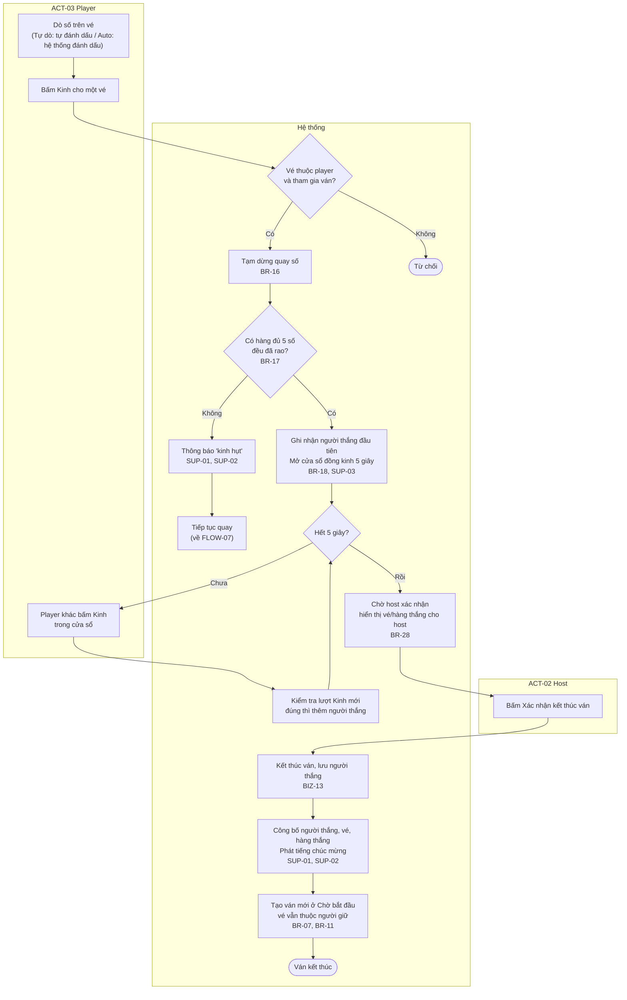

- **Happy path:**
  1. Player dò số trên vé: mode Tự dò thì tự đánh dấu, mode Auto thì hệ thống đánh dấu và làm nổi bật hàng "chờ" (BR-20, SUP-10).
  2. Player bấm "Kinh" cho một vé.
  3. Hệ thống kiểm tra vé thuộc player và nằm trong danh sách vé tham gia ván.
  4. Hệ thống tạm dừng quay số (BR-16).
  5. Hệ thống kiểm tra vé có ít nhất 1 hàng đủ 5 số đều đã rao, kể cả số rao từ trước (BR-17). Đúng thì sang bước 6.
  6. Ghi nhận người thắng đầu tiên, mở cửa sổ đồng kinh 5 giây (BR-18, SUP-03); cả phòng thấy "<tên> KINH! Đang chờ đồng kinh…".
  7. Hết 5 giây: ván chuyển Chờ host xác nhận; không nhận thêm Kinh, không quay số. Host thấy danh sách vé và hàng thắng (BR-28).
  7b. Host bấm "Xác nhận kết thúc ván" (host không bác bỏ được). Ván chuyển Kết thúc, lưu người thắng (tên, màu vé) vào lịch sử (BIZ-13).
  8. Công bố người thắng, vé và hàng thắng cho cả phòng; phát tiếng chúc mừng (SUP-01, SUP-02).
  9. Hệ thống tạo ván mới ở Chờ bắt đầu; vé vẫn thuộc người giữ (BR-07, BR-11). Mọi người được lấy/bỏ vé lại.
- **Alternative paths:**
  - A1. Ván đang tạm dừng do host bấm: vẫn nhận và kiểm tra lượt Kinh (Q-029); nếu hụt thì giữ trạng thái tạm dừng thay vì quay tiếp.
  - A2. Trong cửa sổ đồng kinh, player khác bấm Kinh: kiểm tra như bước 5; đúng thì thêm vào danh sách người thắng, hụt thì báo kinh hụt; quay lại chờ hết cửa sổ (bước 7).
  - A3. Nhiều người bấm Kinh gần như cùng lúc: kiểm tra lần lượt theo thứ tự nhận; người đúng đầu tiên mở cửa sổ, những người sau xử lý theo A2.
  - A4. Một player có 2 vé cùng kinh: bấm Kinh cho từng vé; cả hai vé đều được ghi là vé thắng.
- **Exceptions:**
  - E1. Vé không thuộc player hoặc không tham gia ván (vé bị khóa do người rời/kick – BR-22): từ chối, ván không dừng.
  - E2. Kinh hụt: cả phòng thấy "<tên> kinh hụt", phát tiếng kinh hụt (SUP-02), không phạt (BR-17).
  - E3. Sau kinh hụt: quay số tiếp tục theo nhịp (về FLOW-07 bước 1).
  - E4. Player mất kết nối sau khi bấm Kinh: kết quả vẫn được tính.
  - E5. Host offline lúc cần xác nhận: ván đứng ở Chờ host xác nhận, cả phòng thấy "Đang chờ host xác nhận"; chấp nhận ván không kết thúc được tới khi host quay lại (Q-048). Phòng quá hạn 8 giờ: ván tự Kết thúc với người thắng đã xác định rồi đóng phòng (Q-042).
  - A5. Chính host là người kinh: host vẫn tự bấm xác nhận.
- **Supporting kích hoạt:** SUP-10 tại bước 1; SUP-03 tại bước 6; SUP-01 tại bước 6, 8, E2; SUP-02 tại bước 8, E2.
- **Business rules áp dụng:** BR-20 bước 1; BR-16 bước 4; BR-17 bước 5, E2; BR-18 bước 6, A2; BR-28 bước 7, 7b, E5; BR-07 và BR-11 bước 9; BR-22 tại E1.

### FLOW-09 Chuẩn bị kho tiếng rao (BIZ-09)
- **Actor:** ACT-07 Đội phát triển · **Trigger:** Trước khi phát hành; khi muốn đổi bộ tiếng · **Kết quả:** Kho tiếng rao đầy đủ được nạp vào sản phẩm

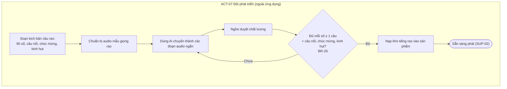

- **Happy path:**
  1. Soạn kịch bản: câu rao cho từng số 1–90 (có thể nhiều câu/số), câu nối, câu chúc mừng người thắng, câu kinh hụt.
  2. Chuẩn bị audio mẫu giọng rao lô tô.
  3. Dùng AI tạo các đoạn audio ngắn theo kịch bản.
  4. Nghe duyệt chất lượng.
  5. Kiểm tra đủ theo BR-26.
  6. Nạp vào sản phẩm; từ đó FLOW-07/FLOW-08 phát được (SUP-02).
- **Alternative paths:**
  - A1. Đổi bộ tiếng sau phát hành: lặp lại 1–6; các phòng đang chơi dùng bộ mới từ số kế tiếp.
- **Exceptions:**
  - E1. Thiếu câu cho vài số nhưng vẫn phát hành: các số đó chỉ hiển thị, không phát tiếng (Q-029).
- **Supporting kích hoạt:** SUP-02 (tiêu thụ kho).
- **Business rules áp dụng:** BR-26 bước 5.

### FLOW-10 Kick player (BIZ-10)
> Cập nhật từ Phase 3 – Q-048: bỏ chuyển host; host chỉ kick được player.
- **Actor:** ACT-02 Host, ACT-05 Hệ thống · **Trigger:** Host chọn một player và bấm Kick · **Kết quả:** Player bị đưa ra khỏi phòng và bị chặn

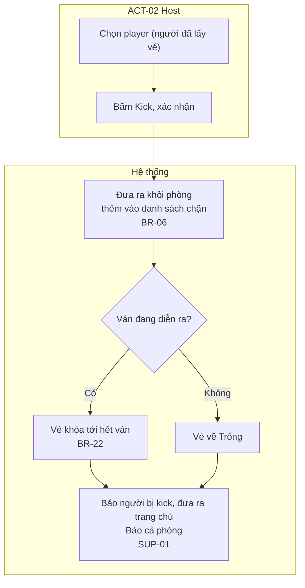

- **Happy path:**
  1. Host chọn một player (người đã lấy vé ở ván hiện tại, không phải chính mình).
  2. Host bấm "Kick", xác nhận.
  3. Người đó bị đưa ra khỏi phòng và vào danh sách chặn (BR-06).
  4. Vé của họ: ván đang diễn ra thì khóa tới hết ván; không thì về Trống ngay (BR-22).
  5. Người bị kick thấy "Bạn đã bị mời ra khỏi phòng", về trang chủ; cả phòng thấy (SUP-01).
- **Alternative paths:**
  - A1. Người bị kick đang offline: vẫn bị kick; thấy thông báo khi mở lại ứng dụng.
- **Exceptions:**
  - E1. Người chưa lấy vé hoặc chính host: không có nút Kick.
- **Supporting kích hoạt:** SUP-01 tại bước 5.
- **Business rules áp dụng:** BR-06 bước 3; BR-22 bước 4.

### FLOW-11 Rời phòng (BIZ-11)
> Cập nhật từ Phase 3 – Q-048: host không rời phòng được; phòng chỉ đóng khi hết hạn.
- **Actor:** ACT-03 Player (trừ host), ACT-05 Hệ thống · **Trigger:** Bấm "Rời phòng" · **Kết quả:** Người dùng không còn ở phòng

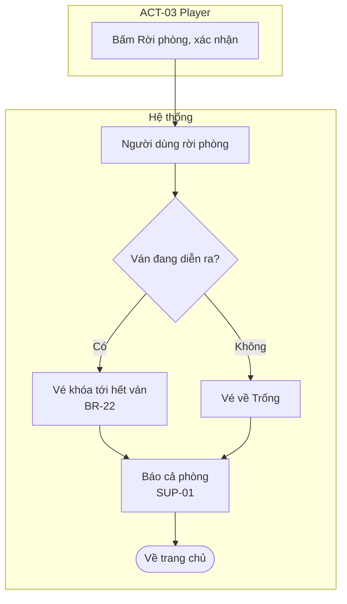

- **Happy path:**
  1. Player bấm "Rời phòng", xác nhận.
  2. Người dùng rời phòng.
  3. Vé: ván đang diễn ra thì khóa tới hết ván; không thì về Trống ngay (BR-22).
  4. Cả phòng thấy "<tên> đã rời phòng" (SUP-01).
  5. Người rời về trang chủ, có thể tạo/vào phòng khác (BR-02).
- **Alternative paths:**
  - A1. Người đã rời muốn quay lại: dùng link còn hạn (FLOW-03 A2, BR-25).
- **Exceptions:**
  - E0. Ván đang diễn ra: nút "Rời phòng" bị khóa, chờ ván kết thúc (cập nhật từ Phase 3 – Q-052).
  - E1. Host: không có nút "Rời phòng"; host ở phòng tới khi phòng hết hạn (BR-21).
- **Supporting kích hoạt:** SUP-01 tại bước 4.
- **Business rules áp dụng:** BR-22 bước 3; BR-02 bước 5; BR-25 tại A1; BR-21 tại E1.

### FLOW-12 Chat trong phòng (BIZ-12)
- **Actor:** ACT-03 Player, ACT-05 Hệ thống · **Trigger:** Gửi tin nhắn · **Kết quả:** Tin nhắn hiện cho cả phòng

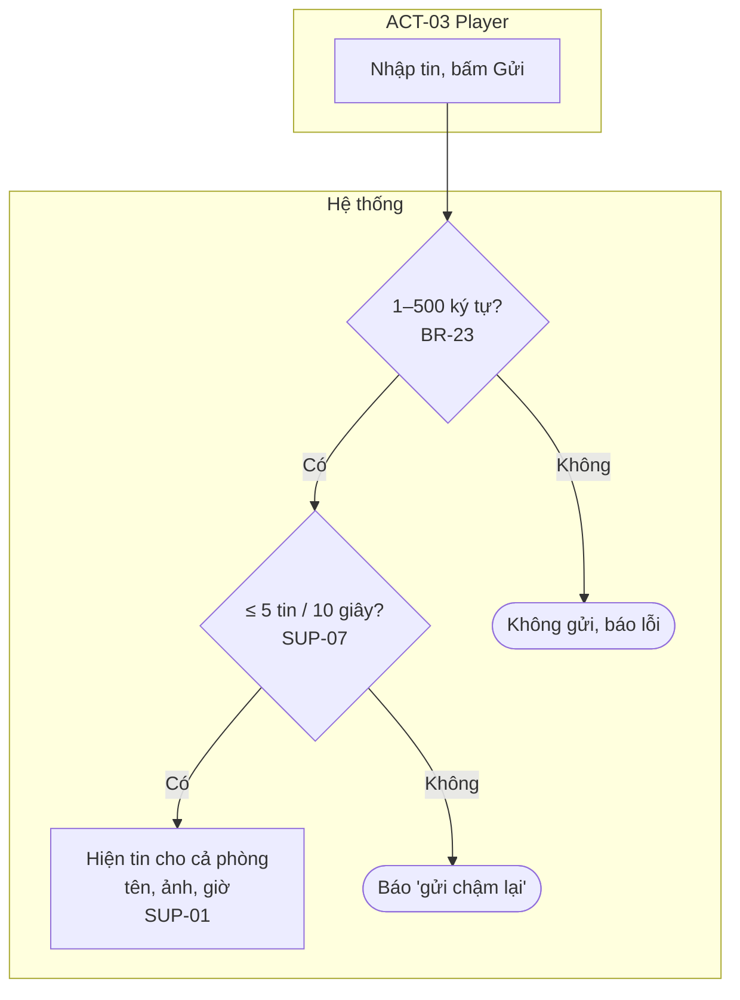

- **Happy path:** 1. Player nhập tin (text/emoji), bấm Gửi. 2. Kiểm tra 1–500 ký tự (BR-23). 3. Kiểm tra không quá 5 tin/10 giây (SUP-07). 4. Cả phòng thấy tin kèm tên, ảnh, giờ (SUP-01).
- **Alternative paths:** A1. Người mới vào phòng xem được toàn bộ tin cũ (BR-23). A2. Chat được cả khi ván đang chạy.
- **Exceptions:** E1. Rỗng hoặc > 500 ký tự: không gửi. E2. Quá 5 tin/10 giây: báo "Bạn gửi quá nhanh", giữ nội dung trong ô nhập. E3. Phòng đã đóng: ô chat bị khóa.
- **Supporting kích hoạt:** SUP-07 bước 3; SUP-01 bước 4.
- **Business rules áp dụng:** BR-23 bước 2, 3.

### FLOW-13 Xem lịch sử ván (BIZ-13)
- **Actor:** ACT-03 Player · **Trigger:** Mở "Lịch sử ván" · **Kết quả:** Danh sách ván và người thắng

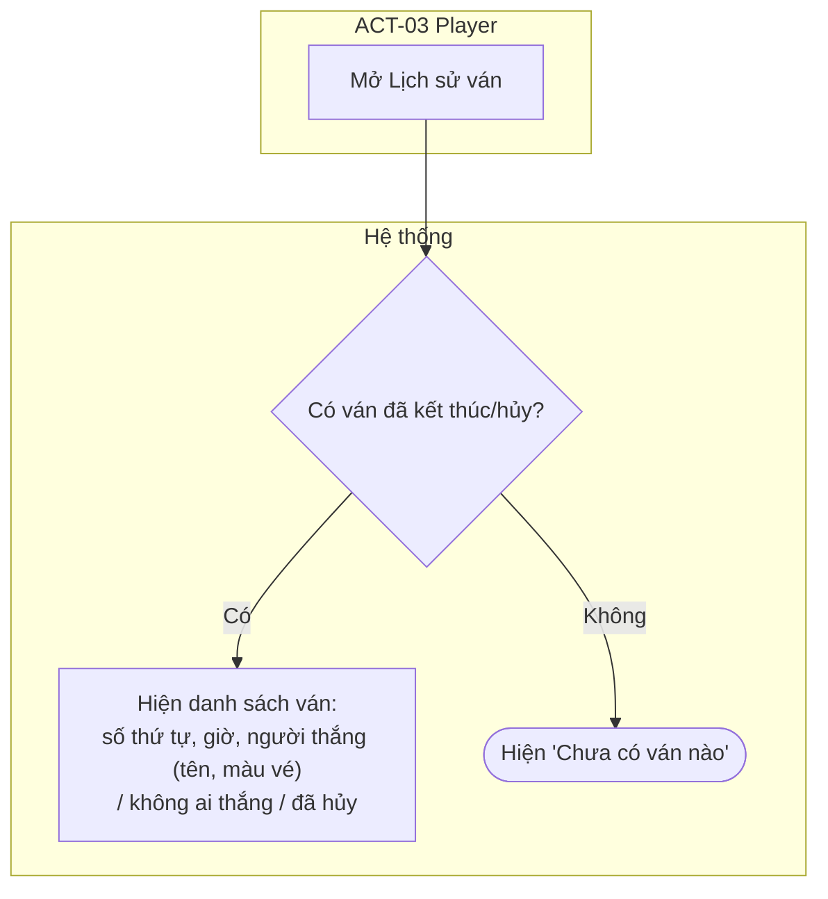

- **Happy path:** 1. Player mở "Lịch sử ván". 2. Hệ thống lấy các ván Kết thúc/Đã hủy của phòng. 3. Hiện danh sách mới nhất trước: số thứ tự, giờ bắt đầu/kết thúc, người thắng (tên, màu vé) hoặc "Không ai thắng"/"Đã hủy" (Q-031).
- **Alternative paths:** A1. Ván mới kết thúc: lịch sử tự cập nhật (SUP-01). A2. Phòng đã đóng: không xem được nữa (Q-039).
- **Exceptions:** E1. Chưa có ván nào: hiện trống.
- **Supporting kích hoạt:** SUP-01 tại A1.
- **Business rules áp dụng:** —

### FLOW-14 Hết hạn & đóng phòng (BIZ-14)
- **Actor:** ACT-05 Hệ thống (chính), ACT-03 (nhận thông báo) · **Trigger:** Thời gian (còn 15 phút: thiết bị tự cảnh báo; đến hạn 8 giờ: thiết bị đang mở phòng báo hệ thống, hoặc hệ thống phát hiện ở lần thao tác kế tiếp (cập nhật từ Phase 3 – Q-051)); ván kết thúc khi phòng Chờ đóng · **Kết quả:** Phòng Đã đóng

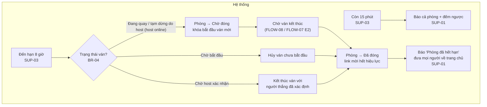

- **Happy path:**
  1. Còn 15 phút: cả phòng thấy cảnh báo và đếm ngược (SUP-03, SUP-01).
  2. Đến hạn 8 giờ: thiết bị trong phòng báo hệ thống (hoặc lần thao tác kế tiếp); hệ thống xem trạng thái ván (BR-04).
  3. Ván ở Chờ bắt đầu: hủy ván, sang bước 5.
  4. Ván Đang quay hoặc Tạm dừng do host (host vẫn online): phòng Chờ đóng, không cho bắt đầu ván mới; khi ván kết thúc thì sang bước 5 (Q-028, Q-029).
  5. Phòng Đã đóng; mọi link mời hết hiệu lực; hủy hẹn giờ còn lại.
  6. Mọi thành viên thấy "Phòng đã hết hạn", được đưa về trang chủ, có thể tạo/vào phòng khác (BR-02).
- **Alternative paths:**
  - A1. Ván ở/tới bước Chờ host xác nhận khi phòng đã quá hạn: ván tự Kết thúc với người thắng đã xác định, lưu lịch sử, rồi đóng phòng (Q-042, Q-048, BR-28).
  - A2. Ván đang chạy mà host offline: phòng Chờ đóng, ván chạy tới khi có Kinh (A1) hoặc hết 90 số.
- **Exceptions:**
  - E1. Thành viên offline lúc đóng: khi mở lại ứng dụng thấy thông báo phòng đã hết hạn.
- **Supporting kích hoạt:** SUP-03 bước 1, 2; SUP-01 bước 1, 6.
- **Business rules áp dụng:** BR-04 bước 2–4; BR-05 bước 5; BR-28 tại A2.

### FLOW-15 Cài đặt cá nhân trong phòng (BIZ-15)
- **Actor:** ACT-03 Player · **Trigger:** Đổi mode dò / bật-tắt tiếng · **Kết quả:** Áp dụng ngay cho người đó

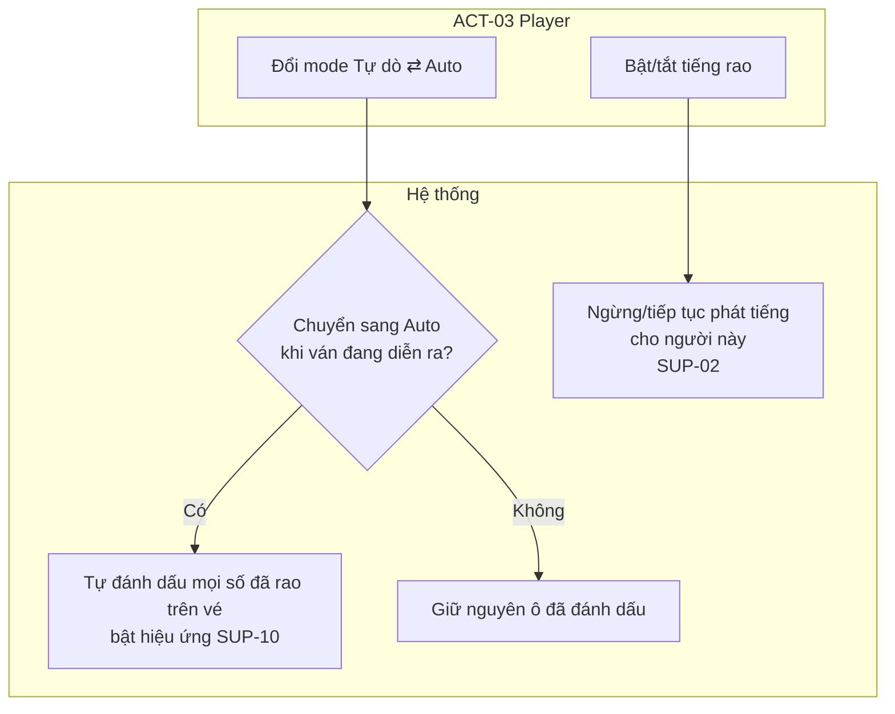

- **Happy path:** 1. Player đổi mode. 2. Nếu chuyển sang Auto trong ván: mọi số đã rao trên vé được tự đánh dấu, bật hiệu ứng (BR-20, SUP-10). 3. Bật/tắt tiếng: áp dụng ngay, chỉ cho người đó (SUP-02).
- **Alternative paths:** A1. Chuyển Auto → Tự dò: giữ các ô đã đánh dấu, tắt hiệu ứng. A2. Cài đặt giữ nguyên qua các ván trong phòng.
- **Exceptions:** —
- **Supporting kích hoạt:** SUP-10 bước 2; SUP-02 bước 3.
- **Business rules áp dụng:** BR-20.

### FLOW-16 Cập nhật hồ sơ cá nhân (BIZ-16)
- **Actor:** ACT-01/ACT-03 · **Trigger:** Mở hồ sơ, đổi tên/ảnh · **Kết quả:** Tên/ảnh mới dùng ở mọi phòng

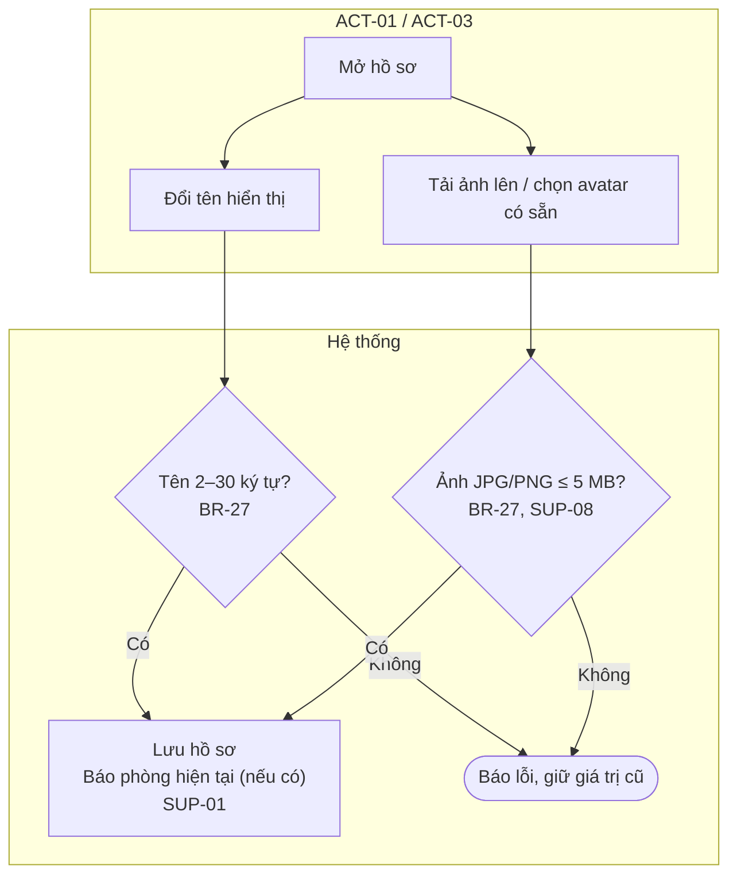

- **Happy path:** 1. Mở hồ sơ. 2. Đổi tên hiển thị và/hoặc ảnh (tải lên hoặc chọn avatar có sẵn). 3. Kiểm tra theo BR-27. 4. Lưu; nếu đang ở phòng, thành viên khác thấy tên/ảnh mới (SUP-01).
- **Alternative paths:** A1. Khôi phục tên/ảnh từ Google.
- **Exceptions:** E1. Tên không hợp lệ hoặc ảnh sai định dạng/quá lớn: báo lỗi, giữ giá trị cũ.
- **Supporting kích hoạt:** SUP-08 bước 2; SUP-01 bước 4.
- **Business rules áp dụng:** BR-27 bước 3.

### Vòng đời entity

#### ENT-02 Phòng
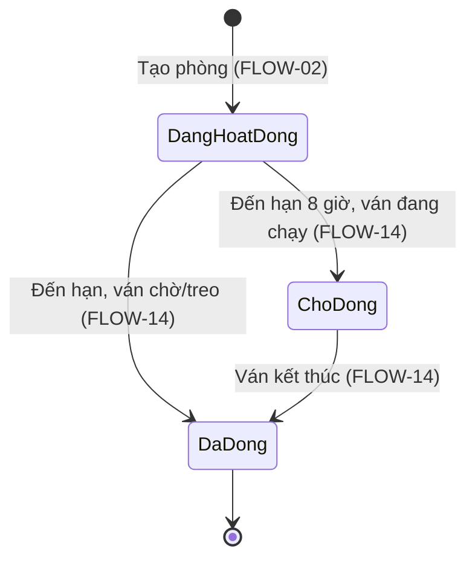
| Trạng thái | → Trạng thái | Do FLOW/bước | Actor |
|---|---|---|---|
| — | Đang hoạt động | FLOW-02 bước 3 | ACT-01 |
| Đang hoạt động | Chờ đóng | FLOW-14 bước 4 | ACT-05 |
| Đang hoạt động | Đã đóng | FLOW-14 bước 3 | ACT-05 |
| Chờ đóng | Đã đóng | FLOW-14 bước 4→5 | ACT-05 |

#### ENT-03 Thành viên phòng
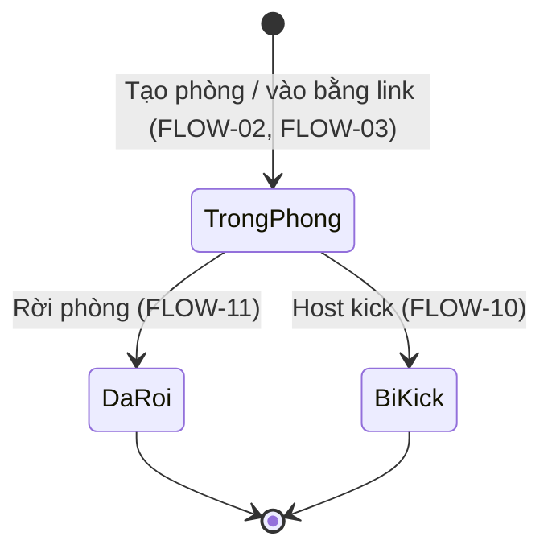
Ghi chú: Online/offline là thuộc tính song song (SUP-04), không phải trạng thái vòng đời. Host cố định, không đổi vai trò (Q-048). Người Đã rời vào lại = lần tham gia mới (FLOW-03 A2).

| Trạng thái | → Trạng thái | Do FLOW/bước | Actor |
|---|---|---|---|
| — | Trong phòng | FLOW-02 bước 4; FLOW-03 bước 12 | ACT-01 / ACT-04 |
| Trong phòng | Đã rời | FLOW-11 bước 3 | ACT-03 |
| Trong phòng | Bị kick | FLOW-10 bước 3 | ACT-02 |
| Trong phòng | (kết thúc khi phòng đóng) | FLOW-14 bước 6 | ACT-05 |

#### ENT-04 Link mời
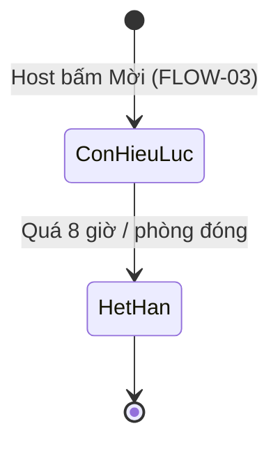
| Trạng thái | → Trạng thái | Do FLOW/bước | Actor |
|---|---|---|---|
| — | Còn hiệu lực | FLOW-03 bước 2 | ACT-02 |
| Còn hiệu lực | Hết hạn | SUP-03 (8 giờ); FLOW-14 bước 5 | ACT-05 |

#### ENT-05 Ván
```mermaid
stateDiagram-v2
  [*] --> ChoBatDau: Tạo phòng / ván trước kết thúc
  ChoBatDau --> DangQuay: Host bấm Bắt đầu (FLOW-06)
  DangQuay --> TamDung: Host tạm dừng / đang kiểm tra Kinh
  TamDung --> DangQuay: Host tiếp tục / kinh hụt
  DangQuay --> ChoDongKinh: Kinh đúng đầu tiên (FLOW-08)
  TamDung --> ChoDongKinh: Kinh đúng khi đang tạm dừng
  ChoDongKinh --> ChoXacNhan: Hết 5 giây
  ChoXacNhan --> KetThuc: Host xác nhận (BR-28)
  DangQuay --> KetThuc: Rao hết 90 số (BR-19)
  ChoXacNhan --> KetThuc: Phòng đã quá hạn
  ChoBatDau --> DaHuy: Phòng đến hạn
  KetThuc --> [*]
  DaHuy --> [*]
```
| Trạng thái | → Trạng thái | Do FLOW/bước | Actor |
|---|---|---|---|
| — | Chờ bắt đầu | FLOW-02 bước 6; FLOW-08 bước 9; FLOW-07 E3 | ACT-05 |
| Chờ bắt đầu | Đang quay | FLOW-06 bước 3 | ACT-02 |
| Đang quay | Tạm dừng | FLOW-06 A1; FLOW-08 bước 4 | ACT-02 / ACT-05 |
| Tạm dừng | Đang quay | FLOW-06 A2; FLOW-08 E3 | ACT-02 / ACT-05 |
| Đang quay / Tạm dừng | Đang chờ đồng kinh | FLOW-08 bước 6, A1 | ACT-05 |
| Đang chờ đồng kinh | Chờ host xác nhận | FLOW-08 bước 7 | ACT-05 |
| Chờ host xác nhận | Kết thúc | FLOW-08 bước 7b; FLOW-14 A2 | ACT-02 / ACT-05 |
| Đang quay | Kết thúc (không người thắng) | FLOW-07 E2 | ACT-05 |
| Chờ bắt đầu | Đã hủy | FLOW-14 bước 3 | ACT-05 |

#### ENT-06 Bộ vé
```mermaid
stateDiagram-v2
  [*] --> HienHanh: Tạo phòng / host tạo bộ mới
  HienHanh --> DaThayThe: Host tạo bộ mới (FLOW-04)
  DaThayThe --> [*]
```
| Trạng thái | → Trạng thái | Do FLOW/bước | Actor |
|---|---|---|---|
| — | Hiện hành | FLOW-02 bước 5; FLOW-04 bước 4 | ACT-05 |
| Hiện hành | Đã thay thế | FLOW-04 bước 4 | ACT-02 |

#### ENT-07 Vé
```mermaid
stateDiagram-v2
  [*] --> Trong: Sinh bộ vé
  Trong --> DangGiu: Player lấy vé (FLOW-05)
  DangGiu --> Trong: Bỏ vé / thu hồi / rời, kick khi không có ván
  DangGiu --> BiKhoa: Rời / kick khi ván đang diễn ra
  BiKhoa --> Trong: Ván kết thúc
```
| Trạng thái | → Trạng thái | Do FLOW/bước | Actor |
|---|---|---|---|
| — | Trống | FLOW-02 bước 5; FLOW-04 bước 4 | ACT-05 |
| Trống | Đang giữ | FLOW-05 bước 5 | ACT-03 |
| Đang giữ | Trống | FLOW-05 A1; FLOW-04 A1, A2; FLOW-10 bước 4; FLOW-11 bước 4 | ACT-03 / ACT-02 |
| Đang giữ | Bị khóa | FLOW-10 bước 4; FLOW-11 bước 4 (ván đang diễn ra) | ACT-02 / ACT-03 |
| Bị khóa | Trống | FLOW-08 bước 7b; FLOW-07 E2 | ACT-05 |

Ghi chú: trạng thái "Bị khóa" làm rõ BR-22 (vé của người rời/bị kick giữa ván) – bổ sung so với vòng đời ở business.md.

#### ENT-11 Lượt báo Kinh
```mermaid
stateDiagram-v2
  [*] --> DangKiemTra: Player bấm Kinh
  DangKiemTra --> Dung: Hàng đủ 5 số đã rao
  DangKiemTra --> Hut: Không đủ
  Dung --> [*]
  Hut --> [*]
```
| Trạng thái | → Trạng thái | Do FLOW/bước | Actor |
|---|---|---|---|
| — | Đang kiểm tra | FLOW-08 bước 2 | ACT-03 |
| Đang kiểm tra | Đúng | FLOW-08 bước 5–6, A2 | ACT-05 |
| Đang kiểm tra | Hụt | FLOW-08 E2 | ACT-05 |

## 4. Non-Functional Requirements
> Nguồn: Q-040 (quy mô ≤ 50 phòng, web trên điện thoại là chính, xóa dữ liệu phòng đóng sau 30 ngày). Toàn bộ giá trị được xác nhận ở Q-041.

| ID | Nhóm | Yêu cầu | Chỉ số đo được | Ưu tiên | Áp dụng cho | Q-ref |
|---|---|---|---|---|---|---|
| NFR-01 | Performance | Số mới hiển thị gần như cùng lúc cho mọi thành viên | Lệch giữa các thành viên ≤ 1 giây (P95) | Must | BIZ-07, SUP-01 | |
| NFR-02 | Performance | Sự kiện trong phòng (vào/rời, lấy/bỏ vé, chat, trạng thái ván) tới mọi người nhanh | ≤ 1 giây (P95) | Must | SUP-01 | |
| NFR-03 | Performance | Kết quả bấm Kinh (đúng/hụt) | Hiển thị ≤ 1 giây sau khi bấm (P95) | Must | BIZ-08 | |
| NFR-04 | Performance | Mở phòng từ link trên điện thoại 4G | Dùng được ≤ 3 giây (P75) | Should | BIZ-03 | |
| NFR-05 | Performance | Tiếng rao khớp với số | Bắt đầu phát ≤ 0,5 giây sau khi số hiển thị | Should | SUP-02 | |
| NFR-06 | Scalability | Chịu tải giờ cao điểm | 50 phòng × 16 người = 800 người đồng thời; mở rộng tới 500 phòng không phải làm lại | Must | Toàn hệ thống | Q-040 |
| NFR-07 | Availability | Hệ thống luôn sẵn sàng; mất mạng ngắn không mất ván | Uptime ≥ 99% / tháng; mất kết nối ≤ 30 giây thì tự kết nối lại và khôi phục đúng phòng, vé, số đã rao, ô đã đánh dấu | Must | Toàn hệ thống, SUP-04 | |
| NFR-08 | Fairness | Công bằng, không gian lận | Số quay và kết quả Kinh do hệ thống quyết định, người chơi không đoán trước hoặc can thiệp được; không ai thấy trước số sắp rao | Must | BIZ-07, BIZ-08 | |
| NFR-09 | Security | Kiểm soát quyền | Chỉ đăng nhập Google; mọi thao tác host (bắt đầu, kick, thu hồi, xác nhận) bị từ chối nếu người làm không phải host; link mời không đoán được | Must | Toàn hệ thống | |
| NFR-10 | Privacy / Compliance | Bảo vệ dữ liệu cá nhân theo NĐ 13/2023 | Chỉ thu tên, ảnh, email; email không hiển thị cho người khác; có trang chính sách quyền riêng tư; yêu cầu xóa tài khoản xử lý ≤ 30 ngày | Should | ENT-01 | |
| NFR-11 | Data retention | Lưu trữ có thời hạn | Dữ liệu phòng đã đóng (thành viên, chat, lịch sử ván, vé) xóa sau 30 ngày; số liệu thống kê tổng hợp giữ lâu dài | Must | ENT-02..ENT-11, SUP-09 | Q-040 |
| NFR-12 | Usability | Mobile-first, chơi bằng một tay | Màn hình từ 360px; vé 9×9 đọc được không cần zoom; vùng bấm ≥ 44px; nút Kinh luôn trong tầm thấy khi đang ván | Must | Toàn hệ thống | Q-040 |
| NFR-13 | Compatibility | Mở được từ ứng dụng chat | Chrome Android, Safari iOS (2 bản mới nhất); trình duyệt trong Zalo/Messenger/Telegram. Nơi không hỗ trợ đăng nhập Google thì hướng dẫn "Mở bằng trình duyệt" | Must | BIZ-01, BIZ-03 | |
| NFR-14 | Usability | Âm thanh trên điện thoại | Trình duyệt chặn tự phát tiếng nên khi vào phòng có một lần chạm "Bật tiếng"; sau đó rao tự động | Must | SUP-02 | |
| NFR-15 | Usability | Màn hình không tự tắt khi đang chơi | Giữ màn hình sáng khi ván Đang quay (nếu thiết bị hỗ trợ) | Could | BIZ-07 | |
| NFR-16 | i18n | Ngôn ngữ, múi giờ | Tiếng Việt; giờ GMT+7 | Must | Toàn hệ thống | Q-030 |
| NFR-17 | Observability | Theo dõi vận hành | Ghi lỗi hệ thống; cảnh báo khi tỉ lệ mất kết nối hoặc lỗi > 5% trong 5 phút; thống kê ngày (SUP-09) | Should | Toàn hệ thống | Q-033 |

## 5. Độ phủ
| BIZ | FLOW | SUP liên quan |
|---|---|---|
| BIZ-01 Đăng nhập bằng Google | FLOW-01 | SUP-05, SUP-09 |
| BIZ-02 Tạo phòng | FLOW-02 | SUP-03, SUP-09 |
| BIZ-03 Mời & tham gia phòng | FLOW-03 | SUP-01, SUP-03, SUP-05, SUP-06 |
| BIZ-04 Tạo lại bộ vé | FLOW-04 | SUP-01, SUP-04 |
| BIZ-05 Lấy / bỏ vé | FLOW-05 | SUP-01 |
| BIZ-06 Điều khiển ván | FLOW-06 | SUP-01, SUP-03, SUP-04, SUP-09 |
| BIZ-07 Quay số & rao | FLOW-07 | SUP-01, SUP-02, SUP-03, SUP-10 |
| BIZ-08 Dò số & báo Kinh | FLOW-08 | SUP-01, SUP-02, SUP-03, SUP-10 |
| BIZ-09 Chuẩn bị kho tiếng rao | FLOW-09 | SUP-02 |
| BIZ-10 Kick player | FLOW-10 | SUP-01 |
| BIZ-11 Rời phòng | FLOW-11 | SUP-01, SUP-03 |
| BIZ-12 Chat trong phòng | FLOW-12 | SUP-01, SUP-07 |
| BIZ-13 Xem lịch sử ván | FLOW-13 | SUP-01 |
| BIZ-14 Hết hạn & đóng phòng | FLOW-14 | SUP-01, SUP-03 |
| BIZ-15 Cài đặt cá nhân trong phòng | FLOW-15 | SUP-02, SUP-10 |
| BIZ-16 Cập nhật hồ sơ cá nhân | FLOW-16 | SUP-01, SUP-08 |

## 6. Giả định & Câu hỏi mở
| Loại | Nội dung | Ref |
|---|---|---|
| ĐÃ CHỐT (Q-042) | Tên hiển thị 2–30 ký tự; ảnh JPG/PNG ≤ 5 MB. | BR-27, SUP-08 |
| ĐÃ CHỐT (Q-042) | Trong lúc chờ host xác nhận: không nhận thêm Kinh, không quay số. | BR-28, FLOW-08 |
| ĐÃ CHỐT (Q-042, Q-048) | Phòng quá hạn mà ván ở/tới bước Chờ host xác nhận: ván tự Kết thúc với người thắng đã xác định rồi đóng phòng. | BR-04, BR-28, FLOW-14 A1 |
| ĐÃ CHỐT (Q-042) | Đổi bộ tiếng rao sau phát hành: phòng đang chơi dùng bộ mới từ số kế tiếp. | FLOW-09 A1 |
| OPEN | — (không còn câu hỏi mở) | |
