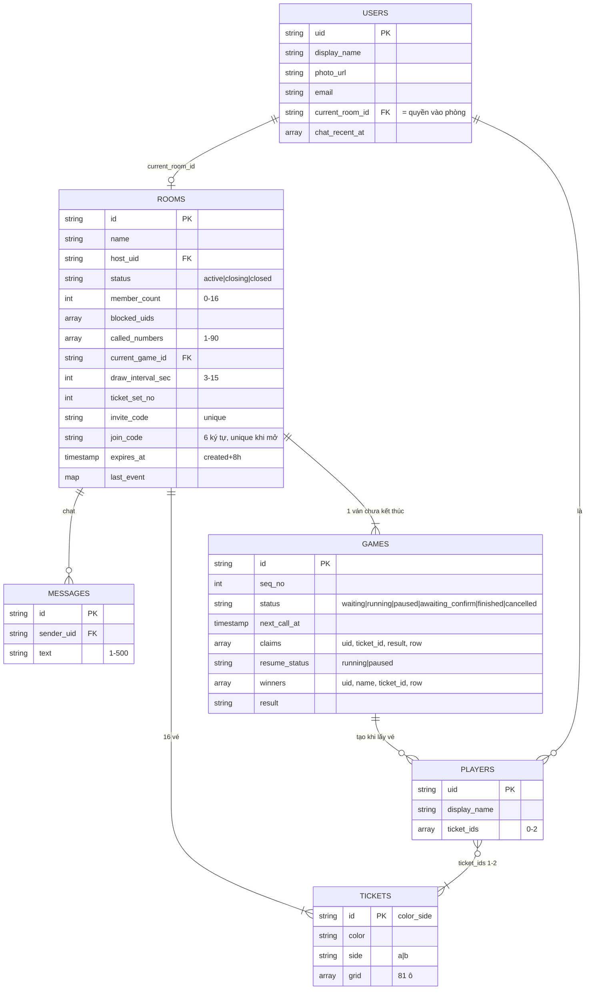

# Database Design

> DBMS: Cloud Firestore Native + Firebase Realtime Database (chỉ cho presence), region `asia-southeast1` (ADR-04, ADR-06) · Chi tiết: `specs/database.md` · Quyết định: Q-045, Q-046, Q-047 · Cập nhật: 2026-11-18

## 1. Nguyên tắc thiết kế
- **Đơn giản nhất có thể (Q-045, Q-046).** Cây dữ liệu:
  ```
  users/{uid}
  rooms/{roomId}                  phòng + called_numbers + mã mời
    tickets/{color_side}          16 vé của bộ hiện hành (chỉ màu + lưới số)
    messages/{messageId}          chat phòng
    games/{gameId}                ván: trạng thái, nhịp, người thắng
      players/{uid}               tạo khi user lấy vé → ticket_ids
  stats/{date}                    thống kê ngày (SUP-09)
  RTDB presence/{roomId}/{uid}    online/offline + tên/ảnh để hiện ai đang trong phòng (SUP-04)
  ```
- **Vòng đời dữ liệu theo action (Q-046):**
  | Action | Ghi gì |
  |---|---|
  | Tạo phòng | `rooms` (host = người tạo, `invite_code` hết hạn cùng phòng 8 giờ) + `games` ván 1 `waiting` + 16 `tickets` ngẫu nhiên |
  | Vào phòng | Chỉ cần `invite_code` (link) hoặc `join_code` (mã phòng – Q-056) (Q-047): server kiểm mã còn hạn, không bị chặn, phòng chưa đầy → `users.current_room_id = roomId`, `rooms.member_count + 1`. **Không** tạo player |
  | Lấy vé | Ván `waiting`: tạo (nếu chưa có) `games/{current}/players/{uid}` và thêm ticket vào `ticket_ids` |
  | Bỏ vé | Bỏ ticket khỏi `players/{uid}.ticket_ids` (doc có thể còn `[]`) |
  | Chat | Thêm doc `rooms/*/messages` |
  | Host Bắt đầu | Xóa các player không có vé hoặc đã rời phòng; còn ≥ 1 player → làm rỗng `rooms.called_numbers`, ván `running` |
  | Rao số | Chỉ append `rooms.called_numbers` |
  | Bấm Kinh | So `tickets/{id}.grid` với `rooms.called_numbers` ngay lúc bấm |
  | Kết thúc ván | Ghi `games.winners` (tên người kinh); tạo ván mới `waiting` và chép sang các player **còn trong phòng** cùng vé của họ (BR-11) |
  | Player out | `users.current_room_id = null`, `rooms.member_count − 1`. Ván `waiting`: xóa player của họ → vé trống ngay. Ván đang chạy: không đổi gì; người đã out không Kinh được; vé trống ở ván sau |
  | Tạo lại bộ vé | Ghi đè lưới số lên 16 doc `tickets` (ID cố định), tăng `ticket_set_no` |
- **Không có** collection cho link mời, bộ vé, lượt Kinh, thông báo. Không có danh sách thành viên trong DB (Q-047). Thông báo ngắn (kinh hụt, vào/rời…) là field `rooms.last_event`, ghi đè mỗi sự kiện; client hiện toast khi field đổi.
- **Ai đang trong phòng** = người có `users.current_room_id = roomId`. Danh sách hiển thị lấy từ RTDB `presence/{roomId}` (mỗi client ghi tên, ảnh, online của mình) và từ `players`.
- **Cài đặt cá nhân** (mode dò, bật/tắt tiếng) và **ô đã đánh dấu** chỉ lưu localStorage của máy, không lưu server.
- **Naming:** collection `snake_case` số nhiều; field `snake_case`. ID: `uid` cho `users`, `players`; `{color}_{side}` cho vé (vd `red_a`); auto-ID cho còn lại.
- **Timestamp:** `timestamp` UTC (`serverTimestamp()`); hiển thị GMT+7 (NFR-16).
- **Ghi:** chỉ server (Admin SDK, ADR-03); Security Rules `allow write: if false`. Ngoại lệ: client ghi node presence của mình ở RTDB.
- **Đọc:** Security Rules cho đọc cây `rooms/{roomId}/**` khi `get(/users/{uid}).current_room_id == roomId` (Q-047).
- **Soft delete / audit:** không. Phòng kết thúc bằng `status = closed`; mọi dữ liệu phòng tự xóa sau 31 ngày bằng TTL (NFR-11). Lịch sử ván = doc `games` đã kết thúc với `winners` (Q-031).

## 2. ERD


## 3. Map Entity → Bảng
| ENT | Bảng | Ghi chú |
|---|---|---|
| ENT-01 Tài khoản | TBL-01 `users` | `current_room_id` = đang ở phòng nào (BR-02) và là quyền đọc phòng (Q-047) |
| ENT-02 Phòng | TBL-02 `rooms` | |
| ENT-03 Thành viên phòng | `users.current_room_id` + `rooms.member_count`; người có vé = TBL-06 `players` | Không lưu danh sách thành viên (Q-047); hiển thị từ RTDB presence |
| ENT-04 Link mời | field `rooms.invite_code`, `rooms.join_code`, `rooms.invite_expires_at` | Tạo cùng phòng, hết hạn cùng phòng (Q-046); mã phòng 6 ký tự (Q-056) |
| ENT-05 Ván | TBL-05 `games` (+ `rooms.called_numbers`) | Số đã rao nằm ở phòng, làm rỗng khi Bắt đầu ván mới (Q-046) |
| ENT-06 Bộ vé | field `rooms.ticket_set_no` | 16 doc `tickets` là bộ hiện hành |
| ENT-07 Vé | TBL-03 `tickets` + `players.{uid}.ticket_ids` | Người giữ chỉ lưu phía player (A1) |
| ENT-09 Tiếng rao | — | File tĩnh `public/audio/` (ADR-08) |
| ENT-10 Tin nhắn chat | TBL-04 `rooms/*/messages` | Chat thuộc phòng (Q-046) |
| ENT-11 Lượt báo Kinh | `games.claims` (đang chờ duyệt, có gợi ý đúng/hụt) → `games.winners` (đúng, sau khi host xác nhận) | Lượt hụt bị xóa khỏi `claims` khi bác bỏ/kết thúc; không lưu lâu dài (Q-031, Q-055) |
| ~~ENT-08~~ | — | Đã gộp vào `rooms.called_numbers` |
| Người chơi trong ván | TBL-06 `games/*/players` | Tạo khi lấy vé; lúc Bắt đầu xóa người không vé (Q-047) |
| SUP-01 Thông báo | `rooms.last_event` + listener `rooms`, `games` | |
| SUP-04 Online/offline | TBL-08 RTDB `presence` | Chỉ để hiển thị và thu hồi vé người offline; host offline không tạm dừng ván (Q-048) |
| SUP-09 Thống kê | TBL-07 `stats` | |

## 4. Quyết định thiết kế
| Chủ đề | Quyết định | Lý do / NFR |
|---|---|---|
| Lưu trạng thái | Field `status` string, giá trị từ stateDiagram; Zod ở server | Firestore không có enum |
| Thành viên không lưu danh sách | Vào phòng = `users.current_room_id`; giới hạn 16 bằng `rooms.member_count` trong transaction | Q-047, BR-03 |
| 1 phòng / người (BR-02) | `users.current_room_id` đọc/ghi trong cùng transaction với `rooms` | BR-02 |
| Vào phòng bằng mã (BR-05, BR-06, BR-30) | Action `joinRoom({inviteCode} \| {roomCode})`: query `rooms where invite_code == code` hoặc `rooms where join_code == code and status == active`, kiểm còn hạn, `status = active`, uid ∉ `blocked_uids`, `member_count < 16`, `users.current_room_id` rỗng | Q-047, NFR-09 |
| Vé đã có chủ (BR-09) | Transaction: query `players where ticket_ids array-contains ticketId` của ván hiện tại; mỗi người ≤ 2 | A1, BR-09 |
| Lấy/bỏ vé chỉ khi chờ (BR-10) | Kiểm `games/{current_game_id}.status = waiting` | BR-10 |
| Player out (BR-22) | Ván `waiting`: xóa doc player → vé trống. Ván đang diễn ra (rời/đăng xuất được – Q-057): giữ nguyên doc; người out không Kinh được (= vé bị hủy); ván mới không chép họ → vé trống. Không cần trạng thái vé "khóa" | Q-046, Q-047, Q-057 |
| Trả vé người offline (BR-29) | Lúc ván kết thúc, server đọc RTDB `presence/{roomId}` bằng Admin SDK; chỉ chép player `online = true` sang ván mới | Q-058 |
| Mã phòng (BR-30) | `createRoom` sinh `join_code` 6 ký tự ngẫu nhiên (`crypto.randomInt`), query trùng trong transaction (`join_code == x and status in [active, closing]`), trùng thì sinh lại (≤ 5 lần) | Q-056; 31⁶ ≈ 887 triệu mã, ≤ 50 phòng mở |
| Rao số (ADR-05) | `startGame` rao số đầu; host + player dự phòng (theo vé nhỏ nhất, +5k giây – Q-052) gọi `drawNumber` khi tới `games.next_call_at`; server chọn `crypto.randomInt` trong 90 − `rooms.called_numbers`, append, đặt `next_call_at` mới; `seq` khử trùng (Q-051) | NFR-08 |
| Kiểm Kinh (BR-17) | Có hàng của `tickets/{id}.grid` mà 5 số đều ∈ `rooms.called_numbers`; `users.current_room_id = roomId` và ticket ∈ `players.{uid}.ticket_ids` | Q-046, NFR-03 |
| Duyệt Kinh (BR-28) | `createClaim` append `games.claims` (gợi ý `win`/`miss`), ván `running`/`paused` → `awaiting_confirm` (lưu `resume_status`); vẫn nhận Kinh khi `awaiting_confirm`. Host: `confirmGame` (khi có `win`) → ghi `winners`; `rejectClaims` (khi toàn `miss`) → làm rỗng `claims`, về `resume_status` | BR-28, Q-055 |
| Thông báo (SUP-01) | `rooms.last_event = {type, text, actor_uid, target_uid, at}` ghi đè | Q-046: tối giản |
| Chống spam (SUP-07) | `users.chat_recent_at` ≤ 5 mốc | BR-23 |
| Tên/ảnh | Chép vào `players`, `messages`, RTDB presence lúc ghi; BIZ-16 cập nhật player của ván hiện tại | Rules không mở `users` của người khác |
| Cài đặt cá nhân, ô đánh dấu | localStorage | Không ảnh hưởng nghiệp vụ server |
| Index | `rooms.invite_code`, `rooms.join_code` (single); `games.seq_no desc`; `messages.created_at` | NFR-02 |

## 5. Data lifecycle
- Mọi doc trong cây `rooms/{roomId}/**` có `expire_at = rooms.created_at + 31 ngày`; TTL policy cho collection group `rooms`, `tickets`, `messages`, `games`, `players` (NFR-11).
- Ván kết thúc: giữ doc `games` (`winners`, `result`, thời gian) và `players` của ván đó (≤ 16 doc). `rooms.called_numbers` được làm rỗng khi ván mới Bắt đầu (Q-031).
- Phòng đóng: `status = closed`, `member_count = 0`; server đặt `users.current_room_id = null` cho người đang ở phòng (query `users where current_room_id == roomId`) → không ai đọc được nữa (Q-039); xóa RTDB `presence/{roomId}`.
- `users`: giữ tới khi có yêu cầu xóa (xử lý tay ≤ 30 ngày – NFR-10). `stats`: giữ lâu dài.

## 6. Migration & seed
- 8 màu vé là hằng số trong code: `red, orange, yellow, green, teal, blue, purple, pink`.
- Avatar có sẵn `public/avatars/`; kho tiếng rao `public/audio/` + `manifest.json`.
- TTL policy và index khai báo trong repo.
- Seed emulator/e2e: 3 user giả, 1 phòng có bộ vé sinh từ seed RNG cố định để test Kinh lặp lại được.
