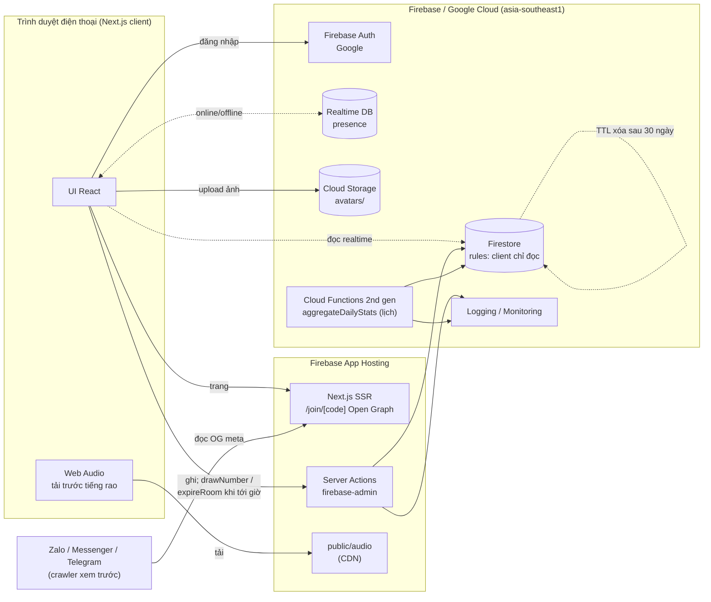

# Tech Stack

> Nguồn: `idea/business.md`, `idea/business-flows.md` (NFR, SUP) · Quyết định: Q-043..Q-051 · Cập nhật: 2026-11-18

## 1. Ràng buộc đầu vào
| Ràng buộc | Giá trị | Nguồn (Q-xxx / NFR-xx) |
|---|---|---|
| Kỹ năng team | TypeScript / Node.js | Q-043 |
| Ngân sách / hạ tầng | Firebase (như dự án buddio): dịch vụ quản lý sẵn, ít vận hành | Q-043 |
| Nền tảng client | Web trên điện thoại là chính, từ 360px; Chrome Android, Safari iOS (2 bản mới nhất); trình duyệt trong Zalo/Messenger/Telegram | Q-040, NFR-12, NFR-13 |
| Quy mô user / tải | ≤ 50 phòng × 16 = 800 người đồng thời; mở rộng tới 500 phòng không làm lại | Q-040, NFR-06 |
| Deadline / time-to-market | Cân bằng: ra MVP nhanh, cấu trúc đủ sạch để mở rộng | Q-043 |
| Tích hợp ngoài | Google Sign-In; thẻ xem trước link trên Zalo/Messenger/Telegram | BR-01, SUP-06 |
| Ngôn ngữ | Tiếng Việt, GMT+7 | NFR-16 |

### Đặc điểm kỹ thuật rút ra từ nghiệp vụ
| Đặc điểm | Nguồn | Hệ quả kỹ thuật |
|---|---|---|
| Vòng quay số theo nhịp 5 / 10 / 15 giây, tạm dừng/tiếp tục, dừng chờ host duyệt Kinh | BR-15, BR-16, BR-28, SUP-03 | Client điều nhịp: `startGame` rao số đầu; host + player dự phòng (cách nhau 5 giây) gọi `drawNumber` khi tới `next_call_at`; server chọn số và kiểm thời điểm (ADR-05, Q-051) |
| Công bằng: không ai biết trước số, kết quả Kinh do hệ thống | NFR-08 | Số chọn ngẫu nhiên bằng `crypto` ngay lúc tick; kiểm Kinh ở server (ADR-03, ADR-05) |
| Realtime: số mới, sự kiện phòng, chat ≤ 1 giây | NFR-01, NFR-02, SUP-01 | Firestore realtime listener (ADR-04) |
| Online/offline để hiển thị và thu hồi vé | SUP-04, BR-13 | Realtime Database `onDisconnect` (ADR-06) |
| Hẹn giờ dài: cảnh báo 15 phút, đóng phòng 8 giờ | BR-04, SUP-03 | Client tự cảnh báo từ `expires_at`, gọi `expireRoom` khi tới hạn; server lazy expiry ở mọi thao tác (ADR-05, Q-051) |
| Xóa dữ liệu phòng sau 30 ngày | NFR-11 | Firestore TTL theo `expireAt` trên mọi tài liệu thuộc phòng (ADR-10) |
| Tiếng rao khớp số ≤ 0,5 giây, trình duyệt chặn tự phát tiếng | NFR-05, NFR-14, SUP-02 | File audio tĩnh qua CDN, tải trước + giải mã bằng Web Audio API sau lần chạm "Bật tiếng" (ADR-08) |
| Thẻ xem trước link mời khi dán vào ứng dụng chat | SUP-06 | Trang `/join/[code]` render ở server với Open Graph meta, không cần đăng nhập (ADR-09) |
| Trình duyệt trong Zalo/Messenger chặn đăng nhập Google | NFR-13 | Nhận diện user-agent in-app, hiện hướng dẫn "Mở bằng trình duyệt" (ADR-07) |
| Quy tắc chéo nhiều: 1 phòng/người, 16 người, 2 vé, vé cặp, quyền host | BR-02, BR-03, BR-09, BR-21, NFR-09 | Ghi qua server trong Firestore transaction (ADR-03) |
| Không có tiền, dữ liệu quan hệ vừa phải | Q-019 | Document DB (Firestore) đủ |

## 2. Stack đã chọn
Phiên bản: dùng bản ổn định mới nhất trong nhánh ghi dưới đây lúc khởi tạo repo, **pin chính xác trong `package.json`**.

| Layer | Công nghệ | Phiên bản | Lý do (ADR) |
|---|---|---|---|
| Ngôn ngữ | TypeScript | 5.x | ADR-02 |
| Runtime | Node.js | 22 LTS | ADR-02 |
| Frontend | Next.js (App Router) + React | Next.js 16.x, React 19.x | ADR-02 |
| UI | Tailwind CSS + shadcn/ui (Radix) | Tailwind 4.x | ADR-02, NFR-12 |
| Validation | Zod (dùng chung client & server) | 4.x (≥ 4.6.6, vá GHSA-mrhx-c7xc-m3w5) | ADR-03 |
| Backend (ghi) | Next.js Server Actions trên App Hosting + `firebase-admin`; Route Handlers chỉ cho `/join/[code]` (SSR) và webhook nội bộ | firebase-admin 13.x | ADR-03 |
| Backend (nền) | Cloud Functions for Firebase 2nd gen: chỉ schedule `aggregateDailyStats` (Q-051) | firebase-functions 6.x | ADR-05, ADR-11 |
| Database | Cloud Firestore (Native), `asia-southeast1` | — | ADR-04 |
| Presence | Firebase Realtime Database, `asia-southeast1` | — | ADR-06 |
| Client SDK | Firebase JS SDK (modular) | 12.x | ADR-03 |
| Auth | Firebase Authentication — Google provider + session cookie `__session` | — | ADR-07 |
| Storage | Cloud Storage for Firebase: `avatars/` (ảnh đại diện) | — | ADR-12 |
| Audio | File tĩnh trong `public/audio/` + `manifest.json`, phát qua CDN của App Hosting; Web Audio API | — | ADR-08 |
| Hosting / Deploy | Firebase App Hosting (nối GitHub, deploy nhánh `main`) | — | ADR-02 |
| CI | GitHub Actions: lint, typecheck, Vitest, test Security Rules + Functions trên Emulator Suite, kịch bản test do AI chạy trên Chrome ở localhost (Q-053) | — | ADR-13 |
| Theo dõi | Cloud Logging, Error Reporting, Cloud Monitoring alert | — | ADR-13, NFR-17 |

**Ước tính chi phí** ở 50 phòng cùng lúc giờ cao điểm: khoảng 0–15 USD/tháng. Chi phí chủ yếu là lượt đọc Firestore: mỗi số rao ≈ 1 ghi + 16 đọc listener, một ván ≈ 50 số. Không dùng Cloud Tasks (Q-051).

## 3. Kiến trúc tổng quan

**Nguyên tắc:**
1. Client **chỉ đọc** Firestore qua listener, giới hạn bởi Security Rules: chỉ thành viên đang trong phòng đọc được phòng, vé, ván, chat. Số kế tiếp chỉ được chọn lúc tick nên client không thể biết trước.
2. Mọi thao tác **ghi** đi qua Server Actions: xác thực phiên, validate bằng Zod, kiểm BR trong Firestore transaction.
3. Mọi việc theo thời gian (rao số, cảnh báo, đóng phòng) do **client gọi API khi tới giờ**; server luôn quyết định bằng giờ server và tự chọn số, nên client không làm nhanh/chậm hay chọn số được (Q-051).

## 4. Architecture Decision Records

### ADR-01 Nền tảng Firebase
- **Bối cảnh:** Team TypeScript, quen Firebase từ dự án buddio, cần realtime và ít vận hành (Q-043).
- **Các phương án:** A. Firebase (managed, realtime sẵn) · B. Postgres + WebSocket server tự dựng · C. Supabase.
- **Quyết định:** A.
- **Hệ quả:** Realtime và auth có sẵn; dùng lại kinh nghiệm và mẫu code của buddio. Mô hình NoSQL phải thiết kế theo truy vấn. Phụ thuộc vào Google Cloud.
- **Ref:** Q-043, NFR-01, NFR-02

### ADR-02 Frontend & hosting: Next.js trên Firebase App Hosting
- **Bối cảnh:** Web mobile-first, mở link là chơi, không cài app (Q-040); cần SSR cho trang mời có thẻ xem trước.
- **Các phương án:** A. Next.js App Router · B. React SPA (Vite) + Firebase Hosting · C. App native.
- **Quyết định:** A — Next.js + React + Tailwind + shadcn/ui, deploy App Hosting.
- **Hệ quả:** Một repo, một ngôn ngữ. Trang mời render ở server (NFR-04 ≤ 3 giây, SUP-06). Chữ giao diện gom trong một file từ điển tiếng Việt (NFR-16).
- **Ref:** Q-040, NFR-04, NFR-12

### ADR-03 Ghi qua server, client chỉ đọc realtime
- **Bối cảnh:** Nhiều quy tắc chéo (BR-02, BR-03, BR-09, BR-10, BR-12, BR-21, BR-28) và yêu cầu công bằng/quyền (NFR-08, NFR-09).
- **Các phương án:** A. Ghi qua server · B. Ghi trực tiếp từ client, Security Rules kiểm quyền · C. Lai.
- **Quyết định:** A, cùng quy ước buddio:
  - Server Actions là transport mặc định; mỗi `operationId` trong `specs/api-contract.yml` ↔ action `<operationId>Action`, trả `ActionResult<T>` = `{ok:true,data}` hoặc `{ok:false,error}`.
  - Một lớp service dùng chung: xác thực phiên → Zod → transaction Firestore bằng `firebase-admin`.
  - Security Rules **cấm mọi ghi từ client**, trừ node presence của chính mình trên RTDB (ADR-06) và `avatars/{uid}` trên Storage (ADR-12).
- **Hệ quả:** Logic nghiệp vụ một chỗ, test được bằng emulator. Mỗi thao tác thêm một chặng mạng (~50–150ms), vẫn trong NFR-02/NFR-03 ≤ 1 giây.
- **Ref:** NFR-08, NFR-09

### ADR-04 Database: Cloud Firestore Native, `asia-southeast1`
- **Bối cảnh:** Người dùng ở Việt Nam, cần realtime listener, quy mô nhỏ–vừa.
- **Quyết định:** Firestore Native, region `asia-southeast1` (Singapore). RTDB, Functions, Storage cùng region.
- **Hệ quả:** Độ trễ từ VN ~30–60ms. Dữ liệu cá nhân lưu ở Singapore là chuyển dữ liệu ra nước ngoài theo NĐ 13/2023, cần hồ sơ đánh giá tác động (NFR-10); việc pháp lý, không chặn thiết kế.
- **Ref:** NFR-01, NFR-07, NFR-10

### ADR-05 Vòng quay số & hẹn giờ: client điều nhịp, server quyết định
> Cập nhật Q-051: thay phương án Cloud Tasks (Q-044) bằng client điều nhịp.
- **Bối cảnh:** Rao một số mỗi N giây (5 / 10 / 15) khi ván Đang quay; tạm dừng/tiếp tục; dừng khi có Kinh chờ host duyệt (Q-055); cảnh báo còn 15 phút, đóng phòng sau 8 giờ. User muốn bỏ hẹn giờ phía server (Q-051).
- **Các phương án:** A. Cloud Tasks hẹn từng tick (Q-044, đã bỏ) · B. Game server Node + Socket.IO · **C. Client điều nhịp, server quyết định**.
- **Quyết định:** C.
  - **Rao số – `drawNumber({seq})`:** client của **host** gọi đúng lúc `games.next_call_at`. **Dự phòng (Q-052):** player của ván (trừ host) xếp theo vé nhỏ nhất họ giữ theo thứ tự cố định Đỏ A → Hồng B; người thứ k gọi ở `next_call_at + 5k giây` nếu chưa thấy số mới, lần lượt tới player cuối. Người không có vé không gọi. **Số đầu tiên** do `startGame` rao ngay.
  - **Server quyết định:** trong transaction kiểm ván `running`, `seq == len(called_numbers)` (khác → trả `drawn: false`, lượt trùng vô hại), `now ≥ next_call_at − 300ms` (sớm → `DRAW_TOO_EARLY`); chọn số bằng `crypto.randomInt` trong các số chưa rao, append `rooms.called_numbers`, `next_call_at = now + draw_interval_sec`. Client không chọn số, không đẩy nhanh được (NFR-08).
  - **Tạm dừng/Tiếp tục:** `paused` → `drawNumber` bị từ chối; `resumeGame` đặt `next_call_at = now + N`.
  - **Duyệt Kinh (Q-055):** bỏ cửa sổ đồng kinh 5 giây và `closeClaimWindow` — không còn hẹn giờ cho Kinh. `createClaim` chuyển ván sang `awaiting_confirm` (`next_call_at = null`, `drawNumber` bị từ chối); host gọi `confirmGame` hoặc `rejectClaims` (`rejectClaims` đặt lại `next_call_at = now + N`).
  - **Hết hạn phòng:** client tự hiện cảnh báo còn 15 phút từ `rooms.expires_at`; tới hạn gọi `expireRoom`. Server **lazy expiry**: mọi thao tác trên phòng (và `joinRoom`, `createRoom` khi `current_room_id` trỏ phòng quá hạn) áp dụng BR-04 trước khi xử lý. Phòng không ai mở sẽ đóng ở lần truy cập kế tiếp — không ảnh hưởng ai.
  - Đồng hồ client lệch → dùng `serverTimeOffset` (tính từ thời gian server trả trong response) khi so `next_call_at`.
- **Hệ quả:**
  - Bỏ Cloud Tasks và 4 function; chỉ còn `aggregateDailyStats`. Chi phí ~0.
  - Trình duyệt hãm timer khi tab ẩn/màn hình tắt: host ẩn tab thì dự phòng gánh; **tất cả** cùng ẩn thì ván dừng tới khi có người mở lại — chấp nhận (Q-051). Wake Lock (NFR-15) giảm khả năng này.
  - Nhịp phụ thuộc mạng người gọi: lệch ~0,2–0,5 giây; vẫn trong NFR-01 (đồng bộ ≤ 1 giây do tất cả cùng đọc listener).
  - Thêm ~1–3 request mỗi số (host + dự phòng), ~150 request/ván — không đáng kể.
- **Ref:** Q-044, Q-051, Q-055, BR-04, BR-15, BR-16, BR-28, NFR-01, NFR-08, NFR-15
### ADR-06 Online/offline bằng Realtime Database
- **Bối cảnh:** Hiển thị ai đang online trong phòng; host thu hồi vé người offline (BR-13). Host offline **không** tạm dừng ván (Q-048).
- **Các phương án:** A. RTDB `onDisconnect` · B. Firestore + heartbeat (tốn ghi, trễ) · C. Bỏ presence.
- **Quyết định:** A.
  - Client ghi `presence/{roomId}/{uid} = {online: true, at}` và đăng ký `onDisconnect` đặt `online: false`. RTDB rules: mỗi người chỉ ghi node của mình, khi `presence_access/{roomId}/{uid}` do server đặt lúc vào phòng.
  - Client ghi kèm tên, ảnh vào node presence để hiện danh sách người trong phòng (Q-047). Không có function trigger: presence chỉ để hiển thị và để server kiểm "offline" khi host thu hồi vé (Q-048).
- **Hệ quả:** Mất kết nối không "sạch" (tắt mạng đột ngột) có thể mất tới ~60 giây mới hiện offline; chấp nhận được cho MVP.
- **Ref:** SUP-04, BR-13, Q-048, NFR-07

### ADR-07 Xác thực: Firebase Auth (Google) + session cookie; xử lý trình duyệt trong ứng dụng chat
- **Bối cảnh:** BR-01 chỉ Google; link mời mở từ Zalo/Messenger, nơi Google chặn đăng nhập trong webview (NFR-13).
- **Quyết định:**
  - Firebase Auth Google: redirect trên điện thoại, popup trên máy tính. Sau đăng nhập, action `createSession` tạo session cookie `__session` (httpOnly, secure, sameSite=lax, 14 ngày); server kiểm bằng `verifySessionCookie(checkRevoked)`, theo đúng buddio.
  - Nhận diện user-agent in-app (Zalo, FBAN/FBAV/Messenger, Telegram, Instagram, Line): hiện màn "Mở bằng trình duyệt" với nút copy link. Android: thử mở bằng `intent://…#Intent;scheme=https;package=com.android.chrome;end`.
  - Đường dẫn quay lại sau đăng nhập (`returnTo`) giữ link mời (SUP-05).
- **Hệ quả:** Không tự quản mật khẩu. Hành trình mời qua Zalo/Messenger có thêm một bước cho người dùng iOS.
- **Ref:** BR-01, SUP-05, NFR-13

### ADR-08 Tiếng rao: file tĩnh + Web Audio API
- **Bối cảnh:** Phát rao ≤ 0,5 giây sau khi số hiện (NFR-05); trình duyệt di động chặn autoplay (NFR-14); kho tiếng làm sẵn bởi đội phát triển (BIZ-09).
- **Các phương án:** A. File tĩnh trong repo, phục vụ qua CDN của App Hosting · B. Cloud Storage + signed URL · C. Text-to-speech real-time (loại theo Q-018).
- **Quyết định:** A.
  - Định dạng **AAC (.m4a) mono 48 kbps**, tương thích Safari iOS và Chrome Android.
  - `public/audio/manifest.json` mô tả `{version, numbers: {"1": ["n01a.m4a", …]}, connectors: [...], congrats: [...], miss: [...]}`. Đổi bộ tiếng = đổi `version` (đường dẫn có version để phá cache).
  - Khi người chơi chạm "Bật tiếng" (NFR-14): tạo `AudioContext`, tải và giải mã các câu theo thứ tự ưu tiên (câu nối, chúc mừng, kinh hụt, rồi các số). Tổng ước ~3–6 MB.
  - Client phát khi nhận số mới từ listener. Thiếu câu thì chỉ hiển thị số (Q-029).
- **Hệ quả:** Không tốn chi phí server cho audio. Kho tiếng nạp bằng commit + deploy (FLOW-09).
- **Ref:** SUP-02, BR-26, NFR-05, NFR-14

### ADR-09 Link mời: mã ngẫu nhiên lưu DB + trang SSR có Open Graph
- **Bối cảnh:** Link cần tra ra phòng, hạn 8 giờ (BR-05), không đoán được (NFR-09), và có thẻ xem trước khi dán vào ứng dụng chat (SUP-06).
- **Các phương án:** A. Mã ngẫu nhiên 128-bit (base62, ~22 ký tự) lưu ở field `rooms.invite_code`, tạo cùng lúc tạo phòng và hết hạn cùng phòng (Q-045, Q-046) · B. Token mã hóa tự chứa (như buddio; không cần lưu nhưng link dài).
- **Quyết định:** A.
  - URL `/join/{code}`, `generateMetadata` trả `og:title` "<host> mời bạn chơi lô tô", `og:description` tên phòng, `og:image` ảnh chung tạo sẵn. Không cần đăng nhập để crawler đọc được.
  - Không lộ dữ liệu cá nhân ngoài tên host và tên phòng.
- **Hệ quả:** Link ngắn, dễ chia sẻ. Hạn kiểm lúc mở link (`expiresAt`), không cần job.
- **Ref:** BR-05, SUP-06, NFR-09

### ADR-10 Lưu trữ có thời hạn: Firestore TTL
- **Bối cảnh:** Dữ liệu phòng đã đóng xóa sau 30 ngày (NFR-11). Phòng sống tối đa 8 giờ + thời gian ván kéo dài.
- **Quyết định:** Mọi tài liệu thuộc phòng (rooms, tickets, messages, games, players) có `expireAt = room.createdAt + 31 ngày`, gán ngay lúc ghi. Bật TTL policy cho từng collection group. Phòng đã đóng không ai đọc được (Q-039), nên xóa trễ ≤ 24 giờ là chấp nhận được.
- **Hệ quả:** Không cần job dọn dẹp. Thống kê ngày (ADR-11) tính trước khi dữ liệu bị xóa.
- **Ref:** NFR-11, Q-039

### ADR-11 Thống kê vận hành: function chạy theo lịch
- **Bối cảnh:** SUP-09 cần số người dùng mới/hoạt động, số phòng, số ván, số người trung bình/phòng theo ngày; xem ngoài ứng dụng.
- **Các phương án:** A. `aggregateDailyStats` chạy 00:10 GMT+7, ghi `stats/{yyyy-mm-dd}`, xem bằng Firebase console / Looker Studio · B. Google Analytics for Firebase (đếm theo sự kiện, khó đếm phòng/ván chính xác).
- **Quyết định:** A. Dùng aggregation query (`count()`, `average()`) theo `createdAt` của ngày trước. Người hoạt động = `users.lastActiveAt` trong ngày.
- **Hệ quả:** Rẻ, không cần BigQuery ở MVP.
- **Ref:** SUP-09, NFR-17

### ADR-12 Ảnh đại diện: Cloud Storage `avatars/{uid}`
- **Bối cảnh:** Người dùng tải ảnh JPG/PNG ≤ 5 MB hoặc chọn avatar có sẵn (BR-27).
- **Quyết định:**
  - Client thu nhỏ ảnh về 256×256 WebP trước khi tải lên `avatars/{uid}/{uuid}.webp`. Storage Rules: chỉ chủ sở hữu ghi, `contentType` là `image/*`, ≤ 5 MB. Đọc công khai: ảnh đại diện vốn hiển thị cho người chung phòng, độ nhạy thấp.
  - Action `updateProfile` kiểm đường dẫn thuộc `uid` rồi ghi `users.photoURL`. Avatar có sẵn nằm ở `public/avatars/`.
- **Hệ quả:** Không cần signed URL. Ảnh cũ xóa khi đổi ảnh.
- **Ref:** BR-27, SUP-08

### ADR-13 Chất lượng & vận hành
- **Quyết định:**
  - **CI** (GitHub Actions): lint, typecheck, Vitest (logic sinh vé, kiểm Kinh, BR), test Security Rules + Functions trên Emulator Suite, kịch bản test do AI chạy trên Chrome ở localhost viewport 375×812 (Q-053).
  - **Theo dõi:** Error Reporting; Cloud Monitoring alert khi lỗi function > 5% trong 5 phút, hoặc độ trễ tick so với lịch > 2 giây (NFR-17).
  - **Sao lưu:** Firestore scheduled backup hằng ngày, giữ 7 ngày.
- **Ref:** NFR-07, NFR-17

### ADR-14 Sinh bộ vé ở server
- **Bối cảnh:** Bộ 16 vé, 8 cặp bổ sung đủ 1–90, mỗi vé 9×9, mỗi hàng 5 số, cột theo chục (BR-08); phải ngẫu nhiên và công bằng (NFR-08).
- **Quyết định:** Hàm thuần `generateTicketSet(rng)` ở lớp domain, dùng chung cho action tạo phòng và tạo lại bộ vé. Với mỗi cặp:
  1. Chia số của từng cột cho 2 vé: cột 1 có 9 số (1–9), cột 2–8 có 10 số, cột 9 có 11 số (80–90). Mỗi vé có 45 số.
  2. Với mỗi vé, xếp số vào lưới 9×9 sao cho mỗi hàng đúng 5 ô có số, và số ô có số của mỗi cột bằng lượng số cột đó được chia. Dùng ma trận 0/1 sinh ngẫu nhiên có ràng buộc tổng hàng = 5, tổng cột = c_j, tức bài toán luồng/ghép cặp; thử lại ngẫu nhiên nếu bế tắc.
  3. Trong mỗi cột, số xếp tăng dần từ trên xuống.
  - Unit test kiểm mọi bất biến của BR-08 trên 10.000 bộ sinh ngẫu nhiên.
- **Hệ quả:** Logic thuần, test dễ, không phụ thuộc Firebase.
- **Ref:** BR-08, NFR-08

## 5. Map Supporting → giải pháp kỹ thuật
| SUP | Giải pháp |
|---|---|
| SUP-01 Thông báo trong phòng | Firestore listener trên `rooms/{roomId}` (field `last_event` ghi đè mỗi sự kiện: vào/rời, kinh hụt, kick, đổi host…) và ván hiện tại; client hiển thị toast (Q-046) |
| SUP-02 Phát tiếng rao | ADR-08: file tĩnh AAC + manifest, Web Audio API, chọn ngẫu nhiên câu/số ở client; bật/tắt tiếng lưu localStorage của máy (Q-046) |
| SUP-03 Hẹn giờ | ADR-05: client điều nhịp — `startGame` rao số đầu, `drawNumber` (host + player dự phòng mỗi 5 giây), `expireRoom`; server lazy expiry và kiểm thời điểm; link hết hạn kiểm lúc mở (ADR-09) |
| SUP-04 Online/offline | ADR-06: RTDB `presence` + `onDisconnect`; không trigger |
| SUP-05 Phiên đăng nhập | ADR-07: Firebase Auth + session cookie `__session`; `returnTo` giữ link mời |
| SUP-06 Chia sẻ link mời | Web Share API (`navigator.share`) + copy clipboard; trang `/join/{code}` SSR với Open Graph (ADR-09) |
| SUP-07 Chống spam chat | Action `sendMessage` kiểm `users.chat_recent_at` (mốc thời gian 5 tin gần nhất) trong transaction; quá 5 tin/10 giây trả lỗi `RATE_LIMITED` |
| SUP-08 Ảnh đại diện | ADR-12: Storage `avatars/{uid}`, thu nhỏ ở client, rules giới hạn 5 MB |
| SUP-09 Thống kê vận hành | ADR-11: `aggregateDailyStats` → `stats/{date}` |
| SUP-10 Hiệu ứng mode Auto | Tính ở client từ `called_numbers` + lưới vé: nổi bật số trúng, đánh dấu hàng thiếu 1 số; rung bằng `navigator.vibrate` nếu có |
| NFR-15 Giữ màn hình sáng | Screen Wake Lock API khi ván `running` (nếu trình duyệt hỗ trợ) |
