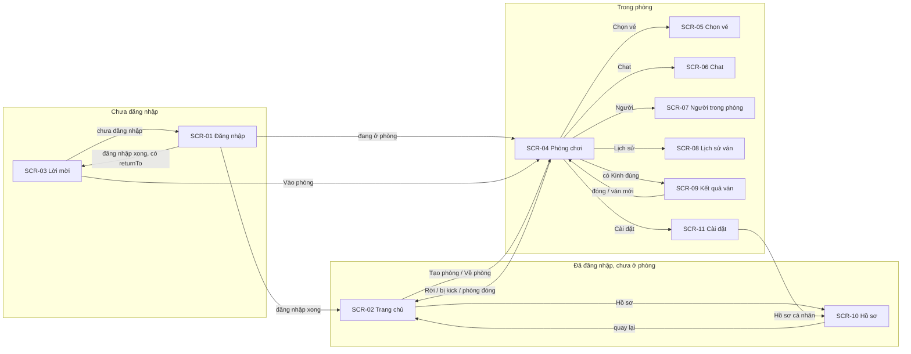

# Wireframe — Danh sách màn hình & điều hướng

> Nguồn: `idea/business-flows.md`, `specs/database.md` · Nền tảng: web mobile-first, từ 360px (NFR-12) · Cập nhật: 2026-11-18

## 1. Danh sách màn hình
"Sheet" = panel trượt từ dưới lên, mở trên nền SCR-04 Phòng chơi; không đổi URL chính.

| ID | Tên màn | Actor | BIZ thể hiện | FLOW | Chi tiết |
|---|---|---|---|---|---|
| SCR-01 | Đăng nhập | ACT-01, ACT-04 | BIZ-01 | FLOW-01 | [scr-01-login.md](./scr-01-login.md) |
| SCR-02 | Trang chủ | ACT-01 | BIZ-02, BIZ-01 | FLOW-01, FLOW-02 | [scr-02-home.md](./scr-02-home.md) |
| SCR-03 | Lời mời vào phòng (`/join/{code}`) | ACT-04, ACT-01 | BIZ-03 | FLOW-03 | [scr-03-join.md](./scr-03-join.md) |
| SCR-04 | Phòng chơi | ACT-02, ACT-03 | BIZ-06, BIZ-07, BIZ-08, BIZ-11, BIZ-14, BIZ-03 (mời) | FLOW-06, FLOW-07, FLOW-08, FLOW-11, FLOW-14 | [scr-04-room.md](./scr-04-room.md) |
| SCR-05 | Chọn vé (sheet) | ACT-03, ACT-02 | BIZ-05, BIZ-04 | FLOW-05, FLOW-04 | [scr-05-tickets.md](./scr-05-tickets.md) |
| SCR-06 | Chat (sheet) | ACT-03 | BIZ-12 | FLOW-12 | [scr-06-chat.md](./scr-06-chat.md) |
| SCR-07 | Người trong phòng (sheet) | ACT-03, ACT-02 | BIZ-10, BIZ-04 (thu hồi vé), SUP-04 | FLOW-10, FLOW-04 | [scr-07-people.md](./scr-07-people.md) |
| SCR-08 | Lịch sử ván (sheet) | ACT-03 | BIZ-13 | FLOW-13 | [scr-08-history.md](./scr-08-history.md) |
| SCR-09 | Kết quả ván (overlay) | ACT-03, ACT-02 | BIZ-08 (đồng kinh, host xác nhận, chúc mừng) | FLOW-08 | [scr-09-result.md](./scr-09-result.md) |
| SCR-10 | Hồ sơ cá nhân | ACT-01 | BIZ-16 | FLOW-16 | [scr-10-profile.md](./scr-10-profile.md) |
| SCR-11 | Cài đặt (sheet) | ACT-03, ACT-02 | BIZ-15, BIZ-06 (nhịp quay) | FLOW-15, FLOW-06 | [scr-11-settings.md](./scr-11-settings.md) |

BIZ-09 (kho tiếng rao) làm ngoài ứng dụng, không có màn (Q-018).

## 2. Sơ đồ điều hướng

## 3. Bảng chuyển màn
| Từ | Hành động | Đến | Điều kiện |
|---|---|---|---|
| (mở app) | — | SCR-01 | Chưa đăng nhập |
| (mở app) | — | SCR-04 | Đã đăng nhập, `users.current_room_id` ≠ null |
| (mở app) | — | SCR-02 | Đã đăng nhập, không ở phòng |
| (link mời) | Mở `/join/{code}` | SCR-03 | Mọi trường hợp; crawler đọc Open Graph |
| SCR-03 | Bấm "Đăng nhập để vào phòng" | SCR-01 | Chưa đăng nhập; giữ `returnTo` |
| SCR-01 | Đăng nhập thành công | SCR-03 / SCR-04 / SCR-02 | Theo thứ tự: có `returnTo` → SCR-03; đang ở phòng → SCR-04; còn lại → SCR-02 |
| SCR-03 | Bấm "Vào phòng" thành công | SCR-04 | Mã hợp lệ (BR-02, BR-03, BR-05, BR-06) |
| SCR-03 | Đang ở chính phòng đó | SCR-04 | Tự chuyển |
| SCR-02 | Tạo phòng / Về phòng hiện tại | SCR-04 | |
| SCR-02 | Bấm avatar | SCR-10 | |
| SCR-11 | Bấm "Hồ sơ cá nhân" | SCR-10 | Đang ở phòng (Q-050); quay lại về SCR-04 |
| SCR-04 | Bấm nút tương ứng | SCR-05, SCR-06, SCR-07, SCR-08, SCR-11 | Sheet, đóng về SCR-04 |
| SCR-04 | Ván sang `claim_window` | SCR-09 | Tự mở cho mọi người |
| SCR-09 | Ván `finished` + bấm Đóng | SCR-04 | Ván mới `waiting` |
| SCR-04 | Rời phòng (player) / bị kick / phòng đóng | SCR-02 | Hiện thông báo lý do |

**Điểm vào sau đăng nhập:** Host/Player đang ở phòng → SCR-04; người dùng khác → SCR-02; đến từ link mời → SCR-03.

## 4. Thao tác trên từng màn (nguồn chung cho API & UI)
"client" = chỉ xử lý ở trình duyệt, không gọi server. "realtime" = đọc Firestore/RTDB qua listener, không cần operation.

| SCR | Mã thao tác | Thao tác | Dữ liệu cần (đọc/ghi) | BIZ | operationId (điền ở api-contract) |
|---|---|---|---|---|---|
| SCR-01 | SCR-01.A1 | Đăng nhập với Google, tạo phiên | ghi: ID token Google → phiên; tạo/cập nhật `users` | BIZ-01 | createSession |
| SCR-01 | SCR-01.A2 | Copy link / Mở bằng trình duyệt (trình duyệt in-app) | client | BIZ-01 (NFR-13) | — (client) |
| SCR-02 | SCR-02.A0 | Tải dữ liệu: hồ sơ + phòng hiện tại | đọc: `users/{uid}` (realtime) | BIZ-01 | — (realtime) |
| SCR-02 | SCR-02.A1 | Tạo phòng | ghi: tên phòng (tùy chọn) → `rooms`, ván 1, 16 vé, `invite_code`, `users.current_room_id` | BIZ-02 | createRoom |
| SCR-02 | SCR-02.A2 | Về phòng hiện tại | client (điều hướng) | BIZ-02 | — (client) |
| SCR-02 | SCR-02.A3 | Đăng xuất | ghi: hủy phiên | BIZ-01 (SUP-05) | deleteCurrentSession |
| SCR-03 | SCR-03.A0 | Tải thông tin lời mời | đọc (server, công khai): tên phòng, tên/ảnh host, số người, trạng thái mã (hợp lệ / hết hạn / đầy / đã đóng) | BIZ-03 | getInvite |
| SCR-03 | SCR-03.A1 | Vào phòng bằng mã | ghi: `code` → `users.current_room_id`, `rooms.member_count`, `last_event` | BIZ-03 | joinRoom |
| SCR-04 | SCR-04.A0 | Tải dữ liệu phòng | đọc realtime: `rooms/{id}`, `games/{current}`, `games/{current}/players`, `tickets` của tôi, RTDB `presence/{roomId}`; ghi RTDB presence của mình | BIZ-06, BIZ-07, BIZ-14 | — (realtime) |
| SCR-04 | SCR-04.A1 | Bật tiếng (lần chạm đầu) | client: tạo AudioContext, tải trước tiếng rao | BIZ-07 (NFR-14) | — (client) |
| SCR-04 | SCR-04.A2 | Đánh dấu / bỏ đánh dấu ô (mode Tự dò) | client: localStorage `gameId:ticketId` | BIZ-08 | — (client) |
| SCR-04 | SCR-04.A3 | Bấm Kinh cho một vé | ghi: `ticketId` → kết quả đúng/hụt; `games.winners` / `claim_window_ends_at` hoặc `rooms.last_event` | BIZ-08 | createClaim |
| SCR-04 | SCR-04.A4 | Bắt đầu ván (host) | ghi: xóa player không vé, `games.status = running`, làm rỗng `rooms.called_numbers`, hẹn tick | BIZ-06 | startGame |
| SCR-04 | SCR-04.A5 | Tạm dừng ván (host) | ghi: `games.status = paused`, `next_call_at = null` | BIZ-06 | pauseGame |
| SCR-04 | SCR-04.A6 | Tiếp tục ván (host) | ghi: `games.status = running`, hẹn tick | BIZ-06 | resumeGame |
| SCR-04 | SCR-04.A7 | Mời: chia sẻ / copy link | đọc: `rooms.invite_code`; client: Web Share API | BIZ-03 (SUP-06) | — (client) |
| SCR-04 | SCR-04.A8 | Rời phòng (không phải host; khóa khi ván đang diễn ra – Q-052) | ghi: `users.current_room_id = null`, `member_count − 1`, xóa player nếu ván `waiting` | BIZ-11 | leaveRoom |
| SCR-04 | SCR-04.A9 | Xem bảng 90 số đã rao | client (từ `rooms.called_numbers`) | BIZ-07 | — (client) |
| SCR-04 | SCR-04.A10 | Tự động: báo tới nhịp rao số (host đúng `next_call_at`; dự phòng = player của ván (trừ host) xếp theo vé nhỏ nhất họ giữ (Đỏ A → Hồng B), người thứ k gọi ở `next_call_at + 5k giây` nếu chưa có số mới, lần lượt tới player cuối (Q-052)) | ghi: `seq` → `rooms.called_numbers`, `games.next_call_at` | BIZ-07 | drawNumber |
| SCR-04 | SCR-04.A11 | Tự động: báo phòng hết hạn khi đếm ngược về 0 (hoặc mở app thấy đã quá hạn) | ghi: `rooms.status`, ván hiện tại | BIZ-14 | expireRoom |
| SCR-05 | SCR-05.A0 | Tải 16 vé và người giữ | đọc realtime: `tickets`, `games/{current}/players` | BIZ-05 | — (realtime) |
| SCR-05 | SCR-05.A1 | Lấy vé | ghi: `ticketId` → tạo/sửa `players/{uid}.ticket_ids` | BIZ-05 | takeTicket |
| SCR-05 | SCR-05.A2 | Bỏ vé | ghi: `ticketId` → bỏ khỏi `players/{uid}.ticket_ids` | BIZ-05 | releaseTicket |
| SCR-05 | SCR-05.A3 | Tạo bộ vé mới (host) | ghi: 16 `tickets.grid`, `rooms.ticket_set_no + 1` | BIZ-04 | renewTicketSet |
| SCR-05 | SCR-05.A4 | Thu hồi vé người offline trong dialog "Tạo bộ vé mới" bị chặn (host) | ghi: `uid` → xóa player của họ ở ván `waiting` | BIZ-04 | reclaimPlayerTickets |
| SCR-06 | SCR-06.A0 | Tải tin nhắn | đọc realtime: `rooms/{id}/messages` theo `created_at` | BIZ-12 | — (realtime) |
| SCR-06 | SCR-06.A1 | Gửi tin | ghi: `text` → `messages`; kiểm `users.chat_recent_at` | BIZ-12 | sendMessage |
| SCR-07 | SCR-07.A0 | Tải người trong phòng | đọc realtime: RTDB `presence/{roomId}`, `players`, `rooms.host_uid` | BIZ-10 (SUP-04) | — (realtime) |
| SCR-07 | SCR-07.A1 | Kick player (host) | ghi: `uid` → `blocked_uids`, `users.current_room_id = null` của người đó, xóa player nếu ván `waiting` | BIZ-10 | kickPlayer |
| SCR-07 | SCR-07.A2 | Thu hồi vé người offline (host) | ghi: `uid` → xóa player của họ ở ván `waiting` | BIZ-04 | reclaimPlayerTickets |
| SCR-08 | SCR-08.A0 | Tải lịch sử ván | đọc: `games` có `status ∈ {finished, cancelled}` theo `seq_no desc` | BIZ-13 | — (realtime) |
| SCR-09 | SCR-09.A0 | Xem người thắng / đếm ngược đồng kinh | đọc realtime: `games/{current}.winners`, `claim_window_ends_at`, `status` | BIZ-08 | — (realtime) |
| SCR-09 | SCR-09.A1 | Xác nhận kết thúc ván (host) | ghi: `games.status = finished`, `confirmed_by`, tạo ván mới, chép player | BIZ-08 | confirmGame |
| SCR-09 | SCR-09.A2 | Tự động: đóng cửa sổ đồng kinh khi hết 5 giây | ghi: `games.status = awaiting_confirm` | BIZ-08 | closeClaimWindow |
| SCR-10 | SCR-10.A0 | Tải hồ sơ | đọc: `users/{uid}` | BIZ-16 | — (realtime) |
| SCR-10 | SCR-10.A1 | Lưu tên hiển thị | ghi: `display_name` | BIZ-16 | updateProfile |
| SCR-10 | SCR-10.A2 | Tải ảnh lên / chọn avatar có sẵn | ghi: file Storage `avatars/{uid}/…` (client), `photo_url` | BIZ-16 | updateProfile |
| SCR-10 | SCR-10.A3 | Khôi phục tên/ảnh Google | ghi: `display_name`, `photo_url` = giá trị Google | BIZ-16 | resetProfile |
| SCR-10 | SCR-10.A4 | Đăng xuất (khóa khi ván đang diễn ra; player = rời phòng; host = đóng phòng – Q-052) | ghi: hủy phiên; rời phòng | BIZ-01, BIZ-11 | deleteCurrentSession |
| SCR-11 | SCR-11.A1 | Đổi mode dò (Tự dò / Auto) | client: localStorage | BIZ-15 | — (client) |
| SCR-11 | SCR-11.A2 | Bật/tắt tiếng rao | client: localStorage | BIZ-15 | — (client) |
| SCR-11 | SCR-11.A3 | Đổi nhịp quay 3–15 giây (host) | ghi: `rooms.draw_interval_sec` | BIZ-06 | updateRoom |

## 5. Layout chung
- **Mobile-first** (360–430px là chính); máy tính hiển thị cột giữa rộng tối đa 480px. Vùng bấm ≥ 44px (NFR-12).
- **Không có sidebar.** Màn ngoài phòng (SCR-02, SCR-10) có header: logo + avatar.
- **SCR-04 Phòng chơi**
  - Header: tên phòng, đếm ngược hết hạn (hiện khi còn ≤ 15 phút), nút Mời (chỉ host).
  - Thanh nút dưới cùng: Vé · Chat · Người · Lịch sử · Cài đặt (mở sheet).
  - Nút **KINH** cố định trên thanh dưới khi ván đang chạy (NFR-12).
  - Thanh điều khiển của host (Bắt đầu / Tạm dừng / Tiếp tục) chỉ host thấy.
- **Thông báo** (SUP-01): toast trên đầu màn khi `rooms.last_event` đổi.
- **Màu vé:** 8 màu cố định, đủ tương phản với chữ số đen.
- Tiếng Việt, giờ GMT+7 (NFR-16).
